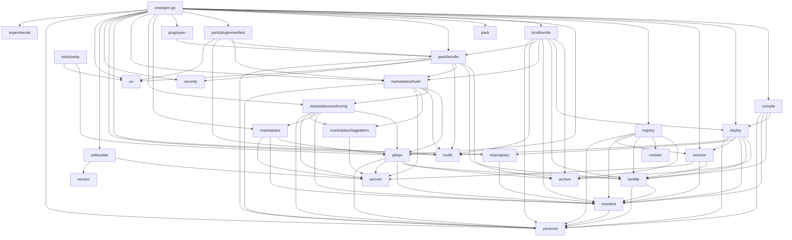
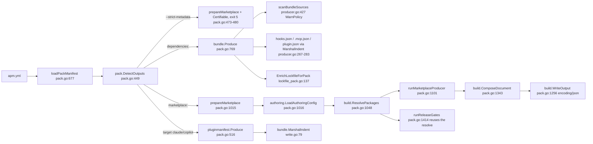
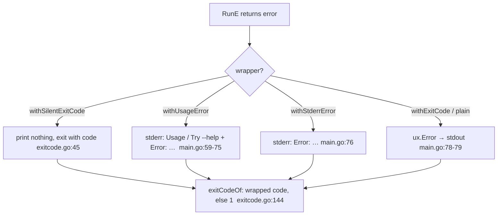

# apm-go architecture

How apm-go is built: the layers, the direction dependencies may point, the data flow of each major command, the cross-cutting mechanisms every layer shares, and the gates a change must pass. Every structural claim is anchored to code as `path:line`. Product facts and the terminal UI design live in [PRODUCT.md](PRODUCT.md); engineering and testing rules live in [AGENTS.md](AGENTS.md). Each topic lives in exactly one of the three files.

Layout: `cmd/apm-go/` holds one file per cobra subcommand; `internal/` holds the libraries listed in §2; `tools/parity/` is the output-contract runner (§5); `spec/conformance/` holds spec tables that tests read at run time.

## 1. Dependency graph

The in-module import graph, from `go list -f '{{.ImportPath}} {{.Imports}}' ./...` (edges from `cmd/apm-go` to every package omitted):



Leaves (import nothing in-module): `archive`, `credsec`, `experimental`, `pack`, `rootfs`, `security`, `semver`, `ux`, `version`, `yamlcore`.

**Dependency rules.** A new edge that the graph lacks is a design change; get a ruling before adding it.

- `yamlcore` is the floor for all YAML and depends only on `go.yaml.in/yaml/v4`; `manifest` depends only on `yamlcore`; `lockfile` only on `manifest` and `yamlcore`.
- `deploy` reads only what is already on disk under `apm_modules/`; fetching (`gitops`, `registry`) stays above it. `resolver` fetches through the injected `resolver.PackageLoader` interface (`internal/resolver/types.go:24`), which keeps `gitops` out of it.
- Terminal output is emitted by `cmd/apm-go`, `pack/bundle`, and `pack/pluginmanifest`; every other package returns diagnostics or errors for the command layer to print.
- `security` has two callers: `pack/bundle` and `cmd/apm-go/audit_content.go` (§4).

## 2. Packages: what each owns, where to enter

| Package | Owns | Entry points |
|---|---|---|
| `cmd/apm-go` | command tree, flags, user-facing text, exit-code mapping | `buildRootCmd` `cmd/apm-go/main.go:20`; `renderRootError` `:56`; `main` `:85`; install summary: `printBlocks` / `printDiagnostics` `install_report.go:143,461`, `lockManaged` / `primarySkillRoot` `install_summary.go:469,306`, `blockHeader` / `printSummaryLines` / `shadowedOutcome` / `collisionCount` / `unpinnedLine` / `resolveRefusedError` `install_summary.go:329,166,481,521,553,25`, `checkFrozenManifestSync` / `lockedRefChanged` / `refUniqueKey` `install_frozen_sync.go:25,70,100`, `checkInsecureDirect` / `newInsecurePolicy` / `insecureLoader` / `checkFrozenInsecure` / `normalizeInsecureHosts` `install_insecure.go:47,76,117,194,31`, `useLockedAliases` / `lockedResolvedDep` `install_frozen_deploy.go:265,276`, `gitPackageIdentity` `install_git_version.go:179`, `fetchedDirsLoader` / `shouldFetch` / `resolvingName` `install.go:3556,3603,3617` |
| `yamlcore` | safe-subset YAML loading, round-trip patching | `SafeLoad` `internal/yamlcore/safe.go:23`; `SafeDump` `:47`; `SafeDumpManifest` `:56`; `PatchMappingPath` / `PatchMappingPathCompact` `patch.go:36,44`; `SpliceSequenceElement` `splice_sequence.go:78`; `RemoveMappingKey` `remove_mapping_key.go:30`; `ReplaceScalarValue` `replace_scalar.go:26` |
| `manifest` | `apm.yml` model, dependency-reference parsing (string and dict forms), MCP entries | `ParseManifest` `internal/manifest/manifest.go:77`; `ParseDepString` `depref.go:270`; `ParseDepDict` `depref.go:1136`; `rejectUnknownFields` / `rejectUnknownRegistryFields` / `ParseAliasField` / `parseAllowInsecureField` `depref_fields.go:45,58,72,95`; `DependencyReference.ModuleDir` `depref.go:1885`; `InsecureDependencyRequirements` / `InsecureDependencyURL` `insecure_dep.go:28,45`; `PyRepr` `pyrepr.go:14`; `ParseMCPEntry` `mcp.go:36`; `ValidateTarget` `target.go:89`; `DetectSignals` `detect.go:47`; `RemovePackagesFromManifest` `remove.go:50` |
| `lockfile` | `apm.lock.yaml` model, serialization in the Oracle's layout (key order, dependency order, the `deployments` section derived from the deployed files), frozen decision, hash verification, the hash of a deployed file | `ParseLockfile` `internal/lockfile/parse.go:79`; `WriteLockfile` / `SerializeLockfile` `write.go:44,56`; `entryFieldOrder` / `topFieldOrder` `write.go:16,31`; `deploymentRows` `deployments.go:68`; `IsSemanticEqual` / `MCPConfigEqual` / `NodesEqual` `write.go:243,368,402`; `SortDependencies` `write.go:461`; `IsCIEnvironment` `frozen.go:9`; `LockedDep.ModuleDir` `types.go:75`; `VerifyDeployedState` `audit.go:26`; `VerifyArchiveBytes` `hash.go:99`; `HashDeployedFile` / `CanonicalDeployedBytes` / `DeployedFileMatches` `deployed_hash.go:17,26,41` |
| `resolver` | BFS dependency resolution, lockfile replay, diamond and orphan detection, update planning | `Resolve` `internal/resolver/resolver.go:21`; `TagLister` / `PackageLoader` `types.go:9,24`; `PlanFullUpdate` / `PlanScopedUpdate` `update.go:12,25`; `ComputeWhy` `why.go:45` |
| `gitops` | hardened git subprocesses, the URL rewrite safety check before a network one, clone, tag listing, stderr translation | `SecureGitEnv` / `ApplySecureGitEnv` `internal/gitops/secure_env.go:32,53`; `ApplyCloneEnv` `harden.go:79`; `cloneCommandFor` / `allowedGitProtocolsHTTP` `harden.go:60,54`; `ValidateURLRewriteSafety` `url_rewrite.go:169`; `RealPackageLoader.LoadPackage` `clone.go:39`; `cloneRepo` / `cloneRepoAtCommit` / `IsCommitRef` `clone.go:309,340,368`; `CheckedOutBranch` `clone.go:394`; `checkoutMatchesRef` / `pinsAutocrlfFalse` `clone.go:196`, `clone_autocrlf.go:21`; `RealTagLister` `tags.go:13`; `TranslateGitStderr` `stderr.go:70` |
| `registry` | package-registry HTTP client, composite loader | `Loader` `internal/registry/loader.go:31` (`LoadPackage` `:48`); `ClientForURL` `:182`; `NewClient` `client.go:61`; `ResolveCredential` `auth.go:47` |
| `archive` | tar/zip extraction under size, count, and path limits; following a symlink of a package tree only inside the package; whether a path below `apm_modules`, every symlink resolved, is still below it | `SafeExtract` `internal/archive/extract.go:51`; `SafeExtractZip` `zip.go:30`; `Limits` `extract.go:25`; `Contained` `extract.go:221`; `CheckPackageDir` `contain.go:72`; `ResolveIn` / `CheckTree` / `SymlinkError` `symlink.go:61,106,17`; `CheckWithin` / `ContainmentError` / `RealPath` / `Within` `contain.go:51,21,86,122` |
| `credsec` | whether to attach a credential, drop it on redirect, redact it in output | `ShouldAttachCredential` `internal/credsec/attach.go:14`; `NewAuthDropRedirect` `redirect.go:30`; `NewRedactor` `redact.go:21` (used by `registry/client.go` only) |
| `rootfs` | write confinement: a directory handle every write and read is resolved against, so no path string decides where bytes land | `OpenRootWriter` `internal/rootfs/rootwriter.go:48`; `Rel` `:79`; `Sub` `:107`; `ReadFile` `:144`; `WriteFile` `:162`; `WriteFileAtomic` `:189`; `WriteFileAtomicMode` `:248`; `CreateAtomic` `:292` |
| `security` | credential/secret scanning with a policy gate | `SecurityGate.ScanFiles` `internal/security/gate.go:66`; `ScanPolicy` `:10`; `BlockPolicy` / `WarnPolicy` / `ReportPolicy` `:33-35`; `ScanFile` / `Classify` `scanner.go:226,257` |
| `deploy` | primitive collection, conflict resolution, per-target writes, MCP writes, removal, whether a path below the deploy root stays in its target root and a written destination in its primitive's directory | `TargetAdapter` `internal/deploy/adapter.go:39`; `DepRefKey` / `DepRefDir` `deploy.go:1063,1052`; `IsAPMPackage` / `SkillName` `identity.go:8,16`; `copyPrimitiveFile` / `copiedBytes` / `comparedContent` / `skillFileBytes` / `oracleText` / `globalCopyText` `line_endings.go:13,30,52,96,114,127`; `linkRun` / `newLinkRun` / `linkSourceOf` / `rewriteLinks` / `rewriteSkillFile` / `urlSplit` / `contextRegistry` `links.go:36,46,91,126,141,422,495`; `MCPTarget` `:43`; `BundleTarget` `:65`; `Adapters` `:85`; `ResolveTargets` `:130`; `Run` `deploy.go:234`; `SkippedDep` `deploy.go:172`; `Shadowed` / `RootSkill` `deploy.go:135,128`; `shadowedPrimitives` / `shadowedContent` / `oracleFinds` / `oracleRels` / `skillDirsEqual` / `rootSkillsCreated` `shadowed.go:35,104,182,204,240,336`; `noteAdopted` `adapter.go:502`; `Managed` / `unmanagedGuard` / `placeFile` `unmanaged.go:19,43,174`; `keepFirstSharedSkill` `deploy.go:899`; `CollectDependencyPrimitives` `primitive.go:179`; `RemoveDeployedFiles` `uninstall.go:52`; `RemoveStaleMCPServers` / `MCPConfigLabel` `mcp_remove.go:93,76`; `UnderKeptDir` `skill_kept_dir.go:27`; `LeftOutThroughLink` `stale_links.go:272`; `walkSkillDir` / `skillCopyRules` `skill_copy.go:77,14`; `skillCopyOnDisk` `shadowed.go:272`; `CheckDeployPath` / `CheckDeployWrite` / `DeployPathError` / `OutsideDeployPaths` / `SkillDirOf` `deploy_path.go:48,63,20,147,212`; `checkFileDest` `adapter.go:519`; `RejectedInstructionError` / `checkInstructions` / `rejectedKind` `deploy.go:160,844,878`; `ReadInstruction` / `normalizeApplyTo` / `escapeApplyToSegment` / `parseApplyTo` / `yamlDoubleQuote` `applyto.go:20,55,77,114,176`; `constructPy` `pyyaml.go:62`; `convertToClaudeRules` / `deployRule` `instructions_claude.go:22,47`; `convertToAntigravityRules` / `convertsAntigravityRules` `instructions_antigravity.go:9`, `antigravity.go:33`; `CollectScopeLocalPrimitives` / `collectFromAPMDir` / `collectFlat` `primitive.go:70,260,340`; `promptCommander` `adapter.go:80`; `readPromptDoc` / `isWorkflowPrompt` / `CommandNote` / `convertPromptToCommand` / `deployPromptCommand` `command.go:48,91,120,148,334`; `pyDump` `pyyaml_dump.go:19`; `keepPromptOverCommand` `deploy.go:1003`; `collectPluginPrimitives` / `stagePluginFiles` / `pluginSourceFiles` / `claudePluginName` / `findPluginManifest` / `componentPaths` / `isAPMPackage` / `pluginCommandPromptName` `plugin.go:53,129,404,179,206,296,315,280`; `withoutRepeatedSkills` / `extractRootAgentName` `primitive.go:498,449`; `rootReadFailure` `source_readable.go:84`; `copilotHookFile` / `projectHookPackage` / `safeSourceName` `copilot.go:54,72,104`; `targetKey` / `copilotOnlyHookTarget` / `resolvePrimitivesBy` `conflict.go:15,29,49`; `DepDeployResult.Recorded` `deploy.go:31` |
| `compile` | `.apm/` instruction collection, AGENTS.md rendering, idempotent write | `Run` `internal/compile/compile.go:296`; `CollectInstructions` `:72`; `readCandidate` `:155`; `RenderAgentsMD` `template.go:39`; `StabilizeBuildID` `buildid.go:16`; `WriteAGENTSMD` `writer.go:55` |
| `marketplace` | source parsing, user registry file, fetch, plugin resolution, validation | `ParseMarketplaceSource` `internal/marketplace/source.go:60`; `Fetch` `client.go:13`; `LoadRegistry` / `AddSource` / `RemoveSource` `registry.go:137,227,246`; `ParseRef` `ref.go:58`; `ResolvePlugin` `resolve_plugin.go:64`; `Validate` `validator.go:105` |
| `marketplace/authoring` | author-side `marketplace:` config (strict schema: name, source, version-or-ref, unique names), `packages` editing, SHA-pin upgrade write-back, ref checks, audit, migration | `LoadAuthoringConfig` `internal/marketplace/authoring/schema.go:233`; `IsConfigValidationError` `:77`; `AddPackage` / `SetPackage` / `RemovePackage` `editor.go:892,1004,1075`; `PlanPackageUpdates` / `PlanPackageUpdatesWith` / `ApplyPackageUpdates` `update.go:63,68,137`; `CheckPackages` `refcheck.go:795`; `OutdatedPackages` / `OutdatedPackagesWith` `refcheck.go:1015,1020`; `CheckPackagesWith` / `CommitProber` / `ManifestVersionFetcher` / `IsDisplayVersion` `refcheck_sha.go:112,54,61,421`; `SubdirObjectReader` / `OutdatedDeps` / `DefaultSubdirObjectReader` `refcheck_sha.go:77,82,93`; `RunAudit` `audit.go:154`; `Migrate` `migrate.go:62` |
| `marketplace/build` | packages → marketplace.json document, each package's metadata outcome and whether it certifies, output paths, drift and version checks | `ResolvePackages` `internal/marketplace/build/builder.go:155`; `MetadataOutcome` / `MetadataEnrichment` / `UsesRemoteMetadata` / `MetadataFor` `metadata_enrichment.go:31,63,111,118`; `ComposeDocument` `output.go:78`; `WriteOutput` `output.go:439`; `EnsureWithinRoot` `output.go:248`; `CheckMarketplaceDrift` `drift_check.go:179`; `CheckVersionAlignment` `version_check.go:253` |
| `marketplace/tagpattern` | tag-pattern validation, compilation, filtering, common-layout inference, the Oracle's x.y.z version grammar | `Validate` / `Compile` / `FilterTags` `internal/marketplace/tagpattern/tagpattern.go:45,77,192`; `IsOracleVersion` `:153`; `Infer` `:163` |
| `mcpregistry` | MCP registry lookup → deployable entry | `NewClient` `internal/mcpregistry/client.go:53`; `ResolveDeployable` `resolve.go:29` |
| `pack` | which of the three outputs a manifest triggers | `DetectOutputs` `internal/pack/detect.go:36` |
| `pack/bundle` | plugin bundle production, JSON value model, MCP sanitizing, lockfile pack section | `Produce` `internal/pack/bundle/producer.go:111`; `MarshalIndent` `jsonvalue.go:195`; `DeepMerge` `:312`; `SanitizeServers` `mcpjson.go:154`; `EnrichLockfileForPack` `lockfile_pack.go:137` |
| `pack/pluginmanifest` | standalone plugin.json | `Produce` `internal/pack/pluginmanifest/producer.go:42`; `Write` `write.go:54` |
| `pluginjson` | init-time plugin.json / .mcp.json scaffold, staged atomic commit; plugin.json validation | `Scaffold` / `ScaffoldAgent` `internal/pluginjson/pluginjson.go:28,55`; `NewStagedScaffold` `stage.go:27`; `Validate` `validate.go:218` |
| `localbundle` | local bundle detection, integrity check, integration | `DetectLocalBundle` `internal/localbundle/detect.go:76`; `VerifyBundleIntegrity` `verify.go:49`; `IntegrateLocalBundle` `integrate.go:96` |
| `ux` | all terminal output and interaction | `Init` `internal/ux/ux.go:33`; `CanPrompt` `:52`; printers `printer.go:21-92`; `SuccessAt` / `ProgressAt` / `InfoAt` / `WarnAt` / `ErrorAt` `printer.go:136,141,146,151,156`; `Panel` `panel.go:28`; `Table` / `List` / `Tree` `output.go:74,144,201`; `Spinner` `spinner.go:42`; `NewClack` `clack.go:130`; `Confirm` / `InputForm` / `MultiSelect` `interactive.go:77,194,146`; Rich-identical `RenderRichTable` / `RichTable` / `TerminalColumns` `richtable.go:51,34,93` and `RenderRichTree` / `RichNode` `richtree.go:24,12` |
| `semver` | range matching, max-satisfying | `Satisfies` / `MaxSatisfying` / `CompareVersions` `internal/semver/semver.go:20,79,71` |
| `experimental` | opt-in feature flags persisted in the user config | `Known` / `IsEnabled` / `RequireEnabled` `internal/experimental/experimental.go:37,100,128` |
| `selfupdate` | binary self-update from GitHub Releases: version check, download with progress, SHA256 verification, binary replacement | `Updater.CheckLatest` `internal/selfupdate/selfupdate.go:63`; `Updater.Apply` `:86`; `PlatformAssetName` `:252`; `replaceBinary` `replace.go:22` |
| `version` | the release version, injected from the git tag at release link time (`dev` locally) | `Version` `internal/version/version.go:14` |

## 3. Data flows

### 3.1 `apm-go install`

```mermaid
sequenceDiagram
  participant C as cmd/apm-go/install.go
  participant M as manifest
  participant R as resolver
  participant L as registry.Loader → gitops.RealPackageLoader
  participant D as deploy
  participant K as lockfile
  C->>C: frozen? (flag or CI) install.go:263
  C->>M: yamlcore.SafeLoad + ParseManifest install.go:338
  C->>K: ParseLockfile install.go:674
  alt frozen
    C->>K: checkFrozenManifestSync :685 / planFrozenDeploy :705 (VerifyDeployedState)
    C->>L: registry: VerifyArchiveBytes :770 + archive.SafeExtract :773
    C->>D: locked files not on disk: frozenDeployPlan.run :878 → deploy.Run in a temporary directory, then in place; no lock write
  else resolve
    C->>R: Resolve(m, lock, tags, regLoader, cfg) install.go:972
    R->>L: PackageLoader.LoadPackage
    L-->>L: registry dep: HTTP download → hash check → SafeExtract loader.go:48
    L-->>L: otherwise: clone under ApplyCloneEnv clone.go:39
  end
  C->>D: ResolveTargets :1981 → deploy.Run :2055
  D->>D: Adapters[target] deploy.go:520
  C->>K: buildLockfile :1776 → installRun.finish install_report.go:410 (IsSemanticEqual + lockIsCanonical :422 → WriteLockfile :425 → writeLockfileBytes :429)
```

1. `installCmd` assembles `installDeps` (`cmd/apm-go/install.go:38`): `tags` is `gitops.RealTagLister`, `loader` is `gitops.RealPackageLoader` (`:179-180`). Tests inject both.
2. `runInstall` (`:231`) decides frozen first; with no flag and `lockfile.IsCIEnvironment()` true it forces frozen and prints an info line (`:249-252`). A frozen install with no `apm.yml`, `--global` included, goes on with an empty manifest and creates no file (`:303`). First, `checkFrozenManifestSync` (`cmd/apm-go/install_frozen_sync.go:25`, called at `install.go:685`) refuses a lock that no longer pins what `apm.yml` declares, the Oracle's `lockfile_satisfies_manifest` (`install/plan.py:453-506`), which its `--frozen` runs before it resolves (`install/service.py:300-353`): for each direct dependency, regular and dev, that is not local, under the key `refUniqueKey` gives it (`:100`, the Oracle's `get_unique_key()`, with the host when it is not github.com), a missing entry, a full 40-hex ref other than the entry's `resolved_commit`, or a change `lockedRefChanged` finds (`:70`, the Oracle's `detect_ref_change`, `drift.py:95-195`, which `shouldFetch` uses too) is one reason line, and the install ends with exit 1 before anything is fetched or written. Then `checkInsecureDirect` (`install.go:688`) runs the HTTP policy of the direct dependencies (step 4), and `useLockedAliases` (`install_frozen_deploy.go:265`, called at `install.go:693`) gives each direct dependency the alias its lock entry records, so the packages are read from the directories the lock has them in, also when the lock an earlier apm-go wrote records no alias that `apm.yml` declares. Then, before any check of the deployed files, fetch or write, `checkFrozenCommitPins` (`cmd/apm-go/install_frozen_commit.go:19`, called at `install.go:694`) refuses a git entry whose `resolved_ref` names a commit (`gitops.IsCommitRef`) and whose `resolved_commit` does not start with it, the Oracle's `_check_locked` (`deps/immutable_requirements.py:116-140`), naming the chain of `resolved_by` up to the root's name (`frozenChain` `:44`). A frozen install checks the deployed files with `lockfile.VerifyDeployedState` under the deploy root (`deployDir`, which is `HOME` for `--global`; `.` otherwise) and reports the first violation, which is fixed because the violations are ordered by `lock.Dependencies`, then local content, each by ascending path. A locked file is not on disk when its violation has no observed hash and `os.Lstat` finds nothing at the path; a file with other content, a dangling symlink, an unreadable file and a directory are the other kind, and the first of those in that order is the error, with nothing written (`planFrozenDeploy` `cmd/apm-go/install_frozen_deploy.go:53`, called at `install.go:705`). When every violation is a file that is not on disk, the frozen install deploys from the lock (issue #65). Before any write or network request the plan needs an `apm.yml`, a target (`deploy.ResolveTargets`; none is `errNoDeployTarget`, exit 2), and for each such path a target that governs it in the bucket that records it (`frozenTargetsGovern` `install_frozen_deploy.go:95`, `deploy.TargetsGovernPath`); without `apm.yml`, or for a path no target governs, the error is the `<missing>` violation of that path. After the source steps (A2) and (B), `frozenDeployPlan.run` (`install_frozen_deploy.go:114`, called at `install.go:878`) copies each local-path direct dependency that has no `apm_modules/<key>` through the loader and builds the `resolver.ResolutionResult` from the lock's dependencies. It then tries the deploy in a temporary directory, which it removes when it returns: `deploy.Run` with that directory as the deploy directory and every other argument as the deploy in place has it (`:151`), so a `--global` trial is a symlink deploy too: a symlink deploy records the symlinks inside a skill's source directory, which a copy deploy skips. The links of a trial point at the sources, and removing the directory removes the links only. Each hash the trial returns has to be the lock's hash for that path in the same bucket (`frozenDeployMatchesLock` `install_frozen_deploy.go:213`; the digests are compared as `VerifyDeployedState` compares them, so a lock with a bare hex digest matches): another hash, or a path the lock does not have (`expected <not in lockfile>`), is a content-integrity error, so sources that changed after the lock was written fail the install; and each locked path that is not on disk has to be among the trial's paths of the bucket that records it (`missingDeployed` `install_frozen_deploy.go:188`), else the error is its `<missing>` violation. A frozen install that fails up to here leaves every path under the deploy root outside `apm_modules/` as it was; the sources this run put in `apm_modules/` stay, as step (B) leaves them. Only then `deploy.Run` runs in place as `deployAndFinalize` calls it (`:163`), `frozenDeployMatchesLock` runs on its result, and `VerifyDeployedState` runs once more. This path writes neither the lock nor `apm.yml` nor `.gitignore`, cleans no stale file, and prints only the frozen success line. `deploy.Run` writes a merged MCP config such as `.mcp.json` as it always does; that file is not verified. Deliberate deviation from the Oracle, whose `--frozen` checks the lock's structure and then runs an ordinary install (`commands/install.py:1758-1762`): it overwrites a changed deployed file and rewrites the lock when the sources changed. Its source step (B) calls the loader for git dependencies only, with a reference rebuilt from the lock entry; the reference of an entry with a `virtual_path` carries the `VirtualType` that parsing `apm.yml` gives that path (`manifest.VirtualTypeOf` `internal/manifest/depref.go:1600`, set at `:793`), because the loader takes only that directory for a subdirectory reference and the whole repository for a reference with no type. The rebuilt reference has no `Scheme`: the lock does not record one. The ref it passes is the entry's `resolved_commit`, so a subdirectory package is cloned at the commit the lock pins. (B) then verifies `tree_sha256` in the entry's directory below `apm_modules/` for each git entry with a commit and a `tree_sha256`, except a subdirectory package (`:868`), whose directory is not a checkout; an entry with none, a subdirectory package's or any of a lock the Oracle wrote, which has no such field, is pinned by `resolved_commit` and `deployed_file_hashes` alone (issue #151). a lock entry whose key starts with `_local/` (`localModulesKeyPrefix` `:3494`, a local-path dependency) is skipped like a `registry` or `local` source (`:770-777`). The current lock records a local package as `source: local`; the key check is for a lock written before issue #50, which records it as a git source with no source path, so the loader would delete the copy and clone it as a git dependency. Such a lock names the package `_local/<name>-<8 hex>` (`legacyLocalModulesKey` `:3443`). A frozen install reads it under that old key (`useLegacyLocalKeys` `:3479`, called at `:669`) and changes no file. A non-frozen install rewrites the whole lock in the current format (step 6), puts the package at `apm_modules/_local/<name>`, and deletes exactly the old directories the old lock names (`removeLegacyLocalModules` `cmd/apm-go/install_report.go:653`). `uninstall` finds the old key too (`uninstallRemovalKey` `cmd/apm-go/uninstall.go:266`). A lock written before issue #114 records a `git:` entry whose value is a local path as a git source keyed by that path (`repo_url: ./repo`, `source: git`; `isGitPathEntry` `cmd/apm-go/install_git_path_lock.go:13`), a key the source step (B) would clone. `useLocalKeysForGitPaths` (`:25`) turns such an entry, in memory, into the record of the local package under its current key `_local/<name>`, its deployed files and hashes kept, and rebuilds the index of `Lockfile.FindByKey` through `RemoveKeys`. A frozen install calls it on the lock it read (`install.go:692`); the install then reads the lock as it is and runs no git. A non-frozen install calls it through `lockUnderCurrentKeys` (`install_stale_cleanup.go:145`), so the package's old record is found as its own, writes the lock in the local format, and `removeLegacyLocalModules` deletes the clone the old entry names, except a directory that is, holds or lies in the directory of a package of the new lock (`overlapsModuleDir` `install_report.go:678`, the paths cleaned as `SafeRemoveModuleDir` cleans them), which applies to the old keys before issue #50 too. `uninstall` copies no package to its current key, so it turns only the entries of the packages it removes (`prepareUninstallPlan`, `uninstall.go:176`) and writes the others back as they are; its hand-over gives a package that stays the old key the lock records it under (`useGitPathKeys` `install_git_path_lock.go:59`, after `useLegacyLocalKeys`), so the trial deploys it from its clone in its declared order.
3. A non-frozen install with a package and no `apm.yml` creates it first, as the Oracle does (`commands/install.py:1469-1498`; issue #81): `createInstallManifest` (`cmd/apm-go/install_bootstrap.go:94`, called at `install.go:316`) writes the bytes of `newManifestBytes` (`install_bootstrap.go:33`), which builds the file with `buildManifestNode` and validates it as `init` does, named after the project directory, or for `--global` after `HOME` (`manifestOwnerName` `:80`), with the `targets:` that `manifestTargetsFromTargetFlag` (`:148`, the Oracle's `manifest_targets_from_target_option`) derives from the raw `--target` tokens, and prints `Created <apm.yml>` and `Targets set: ...`. The rest of the run reads it as an existing `apm.yml`: `installRun.finish` writes the packages into it also when the lock does not change (`manifestCreated`, `install_report.go:434`), and when `runInstall` returns an error a deferred `removeCreatedManifest` (`install_bootstrap.go:113`, `install/transaction.py:37-72`) deletes it. An `apm.yml` that exists is never given a `targets:`. With no package and no `apm.yml` the install prints the Oracle's lines and exits 1 (`errNoManifest` `install_bootstrap.go:125`, called at `install.go:331`). `install --global --mcp` creates `~/.apm/apm.yml` the same way in `runMCPInstall` (`cmd/apm-go/mcpinstall.go:60`), with no comments, because the Oracle writes that file again with `yaml.safe_dump` (`install/mcp/command.py:189-194`), and with the targets the install configures as `targets:` (`mcpManifestTargets` `:230`: `deploy.ResolveTargets` of `--target`, `all` expanded, each target with an MCP adapter once, in order), as the Oracle writes its `supported_runtimes`; a failure before that write leaves no file, and one after it keeps the file, as in Oracle 0.33.0, whose MCP path has no install transaction (`install/mcp/command.py:189-194,312`); a project `install --mcp` still refuses a missing `apm.yml`. `apm.yml` then goes through `yamlcore.SafeLoad` → `manifest.ParseManifest` (`:306`); `ParseDepDict` (`internal/manifest/depref.go:1136`) refuses a field an object form does not take, with the Oracle's texts (`rejectUnknownFields` / `rejectUnknownRegistryFields` `internal/manifest/depref_fields.go:45,58`, the Oracle's `models/dependency/object_fields.py:13-24,49-72` and `registry_entry.py:83-90`), before it checks a value, and reads `alias` and `allow_insecure` as the Oracle does (`ParseAliasField` / `parseAllowInsecureField` `internal/manifest/depref_fields.go:72,95`; `object_fields.py:26-46`, `reference.py:887-891`). A non-frozen install then runs the HTTP policy of the direct dependencies, regular and dev, before anything is fetched (`checkInsecureDirect` `cmd/apm-go/install_insecure.go:47`, called at `install.go:651`; the Oracle's `_check_insecure_dependencies`, `install/insecure_policy.py:193-229`). The string form and the object forms `path:` and `git:` share one test of what a local path is (`localPathOf` `internal/manifest/depref.go:1107`, the Oracle's `is_local_path`; called by `ParseDepString` and by `ParseDepDict` `:1136`) and read the same path, the value without its surrounding whitespace, because `install <local path> --skill` moves the string from one form to the other and it has to stay the same package. A `git:` value that is a local path is that local package, as the Oracle parses it with `parse` (`models/dependency/reference.py:904`): `normalizeLocalDep` keeps its `ref` as `LocalDeclaredRef`, which only `buildLockfile` reads, as `resolved_ref` (`deps/lockfile.py:647`), and its `path:` is not read (issue #114). A value that starts with `//` and a UNC path (`\\host\share`) are not local paths: the string form refuses them with the Oracle's texts (`Protocol-relative URLs are not supported ...`, `errProtocolRelative`; `Use 'user/repo' ...`), and the object form refuses them, `path: dep` and `path: sub/dep` with the Oracle's `Object-style dependency ...` reason; a `path:` value that is empty or not a string gets `'path' field must be a non-empty string`. A local path may point above the project root (`../dep`), as in the Oracle; a package fetched from elsewhere cannot declare a local path at all (`isLocalFilesystemDep`, §3.1 step 4). Its last component, read as Python's pathlib reads it (as a Windows path when it has a backslash), has to be a name (`namesDirectory` `internal/manifest/depref.go:1119`, the Oracle's `reference.py:1812-1821`): `./`, `./.`, `./dep/..`, `/` and `../` are refused in both forms with the Oracle's `Local path '<path>' does not resolve to a named directory. ...`. Every command that parses `apm.yml` then ends with exit 1 before it writes anything; the text before the reason is apm-go's own, not the Oracle's transcript (`install`, `uninstall` and `update` print `validate apm.yml: dependency entry <N> (path: "<value>"): <reason>`). Because of this a `{path: x}` entry whose skill subset is reset is written back as the string `x` (`setEntrySkillSubset` `cmd/apm-go/install.go:3066`). When `install <local path>` adds a local entry, or sets or clears the skill subset of one, the path is written without the whitespace around it, as the Oracle writes it (`setEntrySkillSubset`, `newGitSkillEntry`, `persistPackagesToManifest`); an entry `install <local path>` matches with nothing to change in it keeps its bytes. A local-path dependency's `apm_modules` key and lock `repo_url` is `_local/<directory name>` (`normalizeLocalDep` `:3353`, `localModulesKey` `:3431`), the Oracle's layout. Two local packages with the same directory name are refused before anything is written (`localSources.add` `:3397`, called at `:373-384` for `apm.yml` and at `:538` for a package on the command line; `errLocalNameCollision` `:3386`; exit 1); this is a deliberate deviation from the Oracle (issue #50 ruling R6), which copies the second over the first and exits 0. The same call runs `gitops.CheckLocalCopy` (`internal/gitops/clone.go:482`) on each direct local dependency, so every refusal of a copy described in step 4 is decided before the first copy and leaves the copies of earlier packages as they were; `update` runs it on the dependencies of `apm.yml` before it clears or resolves anything (`cmd/apm-go/update.go:171`). The object forms `path:`, `git:` and `id:` read `targets:` into `DependencyReference.TargetSubset` through `parseDepTargets` (`internal/manifest/depref.go:1443`), a port of the Oracle's `parse_target_subset` (`models/dependency/subsets.py:59-100`) with its reason texts: the names are checked against `knownTargets` (`:1422`), the Oracle's `KNOWN_TARGETS`, which is wider than the targets apm-go deploys to, then lowercased, deduplicated and sorted; `git: parent` refuses the key. The resolver gives each `ResolvedDep` the `TargetSubset` of the reference it kept for the key, the shallowest (`internal/resolver/resolver.go:282`), so a package's own `apm.yml` brings the list of a transitive dependency.
4. Non-frozen: an `http://` dependency is fetched only through `insecureLoader` (`cmd/apm-go/install_insecure.go:117`, which wraps the loader at `install.go:966`): `newInsecurePolicy` (`:76`) approves a direct one with `allow_insecure: true` and `--allow-insecure` and a transitive one whose host `--allow-insecure-host` names or, with `--allow-insecure`, a direct `http://` dependency has (`install/insecure_policy.py:105-191`), the reference is marked `HTTPApproved`, and `gitops.cloneCommandFor` (`internal/gitops/harden.go:60`) runs its clone and tag listing, and no other git command, with `http` added to `GIT_ALLOW_PROTOCOL` (`allowedGitProtocolsHTTP` `:54`), after `ValidateURLRewriteSafety` ran; a transitive one that is not approved is not fetched, and after the resolve `reportInsecure` (`:140`, called at `install.go:977`) prints the warning of each `http://` dependency or refuses the install. `update` builds the same loader with neither flag (`updateInsecureLoader` `cmd/apm-go/update.go`). A package's directory below `apm_modules/` is its `ModuleDir` (`DependencyReference.ModuleDir` `internal/manifest/depref.go:1885`, `ResolvedDep.ModuleDir` `internal/resolver/types.go:104`, `LockedDep.ModuleDir` `internal/lockfile/types.go:75`, `deploy.DepRefDir` `internal/deploy/deploy.go:1052`): its alias when the entry has one, as the Oracle's `build_materialization_path` places it (`models/dependency/materialization.py:106-130`), else its key; the key stays its identity, the lock's key, `resolved_by` and the name `uninstall` and the frozen check take (issue #151). `installPathIn`, the registry loader and the local copy take the directory from it, `archive.CheckPackageDir` (`internal/archive/contain.go:72`) refuses an alias's directory that resolves to `apm_modules` or out of it with the Oracle's texts (`materialization.py:117-129`), and every other reader of a package's directory (`deploy.Run`, `compile`, the stale and orphan cleanups, `uninstall` and its hand-over, `pack`) takes it from the reference or the lock entry; `uninstall` removes a direct package from the directory of its `apm.yml` entry (`uninstallPlan.moduleDir` `cmd/apm-go/uninstall.go`), as the Oracle does (`commands/uninstall/engine.py:750-751,834-835`), and a transitive one from its lock entry's (`:929`). A primitive carries its package's directory (`Primitive.PackageDir`), after which a root skill and a copilot hook's `<package>` are named (`integration/skill_integrator.py:1769`, `integration/hook_integrator.py:901`). Build the composite loader `registry.Loader{Next: deps.loader}` (`:909`) and call `resolver.Resolve` (`:919`); marketplace references resolve through `newMarketplaceResolveFunc` (`cmd/apm-go/marketplace_resolve.go:39`). The loader copies a local package before the resolver can refuse it, so when the resolve fails, the copies this run created under `apm_modules/_local/` are removed (`absentLocalCopies` `:3419`, `removeNewLocalCopies` `:3436`, called at `:936`; ruling R20). Every local copy, in this step, in a frozen install, in `update --dry-run` and in the trial deploy of `uninstall`, goes through `RealPackageLoader.materializeLocalCopy` (`internal/gitops/clone.go:418`), which removes the destination `apm_modules/_local/<name>` and copies the source into it. The copy (`copyTreeDereferencing` `:563`, the Oracle's `install/phases/local_content.py:91-181`) copies a symlink as the file or directory it resolves to when that stays inside the package; a symlink that dangles, resolves outside the package (its target is not read), or leads back to a directory already entered on its own path fails the copy with exit 1. A symlink is resolved by a port of Python 3.12's `os.path.realpath(strict=True)` (`realpathStrict`, `internal/gitops/realpath_other.go:18` and `realpath_windows.go:30`). Outside Windows it is `posixpath.py:420-496`, one component at a time, so a failure names the component Python names and a symlink met again while it is resolved is a loop on that symlink; `filepath.EvalSymlinks` names no path for a loop. On Windows it is `ntpath.realpath`, which opens the whole path once with `CreateFileW` (`os._getfinalpathname`) and raises that call's error as it is (issue #127): the reason names the symlink itself as `[WinError <n>] <message>: '<path>'`, the message being `FormatMessageW`'s in the system language as `Python/errors.c` trims it (`winError` / `winMessage` `realpath_windows.go:53,67`), `ERROR_CANT_RESOLVE_FILENAME` is the loop pathlib reports, and a path that opens is resolved with `filepath.EvalSymlinks`, which spells it as `archive.RealPath` spells the package root it is compared with. The POSIX walk splits only on `/`, so on Windows it failed every relative symlink. Every failure reading the package has the reason the Oracle prints under Python 3.12, its `OSError` text included (`[Errno 2] No such file or directory: '<path>'`, `pyOSError` `:630`, with `repr()` of the path, `manifest.PyRepr` `internal/manifest/pyrepr.go:14`), and a loop is the whole reason `Symlink loop from '<path>'`, as pathlib raises it and the Oracle lets it through. A failure to write the copy keeps apm-go's own text. A failed copy removes the destination and the empty directories `materializeLocalCopy` created for it (`absentDirs` `:544`), so a first install that fails this way leaves no `apm_modules/`. Before it removes or writes anything it runs `gitops.CheckLocalCopy` (`:481`) again, for the paths that do not pass the check of step 3; the check refuses with exit 1, in this order: a destination that, every symlink on it resolved, the last component included, is not below the modules directory resolved (`archive.CheckWithin` `internal/archive/contain.go:51`, called at `clone.go:506`: a symlinked `apm_modules/_local`, or an `apm_modules/_local/<name>` linked outside, refused as Oracle 0.33.0 refuses it, issue #86); a source that is or holds the project directory; a source and destination where one holds the other once symlinks are resolved (a source inside `apm_modules/`). A symlink at the destination that stays inside the modules directory is removed and not followed, so the overlap is judged on the destination with its last component not resolved. The copy reads the source the check resolved, every symlink resolved, not the declared path: a declared path that runs through the destination link (`path: ./apm_modules/_local/dep`) would otherwise read what is left once that link is removed. A source that holds the project is a deliberate deviation from the Oracle, which copies the project into itself until `[Errno 36] File name too long`, exits 1 and leaves `.claude/` behind. A git dependency is a checkout that keeps the repository's symlinks (issue #89). `cloneRepo` (`clone.go:308`) takes a ref of 7 to 40 hex characters, in either case, as a commit (`IsCommitRef` `:368`, the Oracle's `deps/git_reference_resolver.py:553`; issue #124): `cloneRepoAtCommit` (`:340`) clones the whole repository, resolves the ref with `git rev-parse --verify <ref>^{commit}` and checks out that full commit with `--detach`, as the Oracle's `git_resolve_commit` resolves it (`utils/git_env.py:1479-1501`); a ref that does not resolve removes the clone and fails with the Oracle's `Could not resolve commit '<ref>' in repository <repo>: <git error>`, and any other ref is a shallow `clone --branch`. The short ref is never given to `checkout`, whose DWIM would make a local branch of `origin/<ref>`, and `checkoutMatchesRef` (`:196`) does not reuse a checkout of such a ref that is on a local branch of the ref's own name, the checkout an apm-go before issue #124 made with `--branch <ref>`; a checkout on another branch, such as a frozen install's locked commit over a `ref: main` clone, is judged by its commit as before. Its `apm.yml` is read through `parseModuleManifest` (`internal/gitops/clone.go:644`, called at `:65,89`), which resolves it with `archive.ResolveIn` (`internal/archive/symlink.go:61`; called at `clone.go:645`; it compares every symlink target with the package root made absolute and resolved, `realRoot` `:47`, so the relative `apm_modules` and a symlinked `~/.apm` are the same package): a symlink there that leaves the package, dangles or loops fails the resolve with exit 1 (`resolve: loading package <key>: symlink apm.yml ...`), so neither the transitive dependencies nor the MCP servers come from outside the package. A subdirectory package is taken out of a clone in a temporary directory by `cloneAndExtractSubdir` (`clone.go:96`), with the clone as the package root, as in the Oracle (`deps/github_downloader.py:1656-1670`): the `path:` is resolved with `archive.ResolveIn` (`:116`), the directory is checked with `archive.CheckTree` (`:125`; `symlink.go:106`, the first symlink in name order that leaves the clone, dangles, loops, or leads back to a directory the copy is in), both before `apm_modules/<key>` is created, and `copyDirContents` (`:155`) copies each symlink as what it points at. A failed copy removes `apm_modules/<key>` and the empty directories it created (`absentDirs`). A git dependency's `apm_modules/<key>`, a subdirectory package's included, passes `archive.CheckWithin` before the stale checkout is removed or a clone is written (`clone.go:59`), and a registry package's before `archive.SafeExtract` replaces it (`internal/registry/loader.go:120`): both follow a symlinked parent, so one that leads out of `apm_modules` fails the resolve with exit 1 and the Oracle's reason (`Cannot verify containment of '<abs>' within '<base>': ...`, `ContainmentError` `contain.go:21`), before anything is removed or written.
5. Deploy: `deploy.ResolveTargets` (`:1908`) picks targets; `deploy.Run` (`:1976`) collects local primitives, then direct, then transitive dependencies (`internal/deploy/deploy.go:234`) and calls `DeployPrimitive` / `WriteMCP` / `FinalizeBundles` on `Adapters[target]` (`:588`, `:792`, `:751`). A dependency with a `targets:` list deploys only to the active targets it names (issue #69): `Run` takes the list of a direct dependency from `m.ParsedDeps` / `m.ParsedDevDeps` and of a transitive one from `resolved.Deps`, and when any dependency has one it resolves the conflicts of same-named primitives once per target, among the primitives that target allows (`internal/deploy/deploy.go:496`), as the Oracle does (`install/services.py:294`), so one package can win the Claude file and another the Copilot file; a conflict diagnostic met on several targets is reported once. The targets a dependency's own `apm.yml` declares narrow that list again (issue #126 item 25), as `resolve_effective_package_targets` intersects the active targets, the entry's and the package's (`install/target_filter.py:72-150`): `collectDependencySources` returns them through `packageTargets` (`internal/deploy/package_targets.go:22`), which reads the Oracle's `canonical_targets` (`models/apm_package.py:571-600,736-750`), a plural `targets:` with each name only stripped (`core/apm_yml.py:128-163`), so `vscode` there is not copilot, a singular `target:` lowercased, split at commas and its aliases resolved through `manifest.TargetAliases` (`core/target_detection.py:589-700`), `all` anywhere for no restriction; `noteTargetSubset` intersects, and enters a dependency only when the package's targets leave out an active target the entry allows, so a package that names every active target takes the single resolution as before. This parse does not replace the validation of the resolve (`manifest.ParseManifest`), whose differences from the Oracle are not changed. The lock's `target_subset` does not record the package's targets. Line endings (issue #119): a copy deploy writes an agent, an instruction, a prompt and a command through `copyPrimitiveFile` (`internal/deploy/line_endings.go:13`, called by `deployFileToPath` `adapter.go:456`), with the text `oracleText` gives (`line_endings.go:114`), and a rule (claude's, and antigravity's in a project) and codex's TOML agent read their source through `oracleText` in every scope (`instructions_claude.go:80`, `codex_agent.go:54`): content that is valid UTF-8 has each CRLF and each bare CR written as LF, NUL included, as the Oracle reads it with `Path.read_text` and writes it with `write_text_lf` (`integration/agent_integrator.py:358-362`, `utils/atomic_io.py:28-48`), and other content is kept as it is, which the Oracle cannot read (issue #119 comment 6231670262). The one other caller is the copy a `--global` deploy makes when it cannot link (`activeDeployMode.global` with no symlink, issue #118): `copyPrimitiveFile` takes `globalCopyText` there (`line_endings.go:127`), which is `lockfile.CanonicalDeployedBytes` (`internal/lockfile/deployed_hash.go:26`), each CRLF as LF, and keeps the source's bytes when that leaves a CRLF (a CR before a CRLF), so a bare CR and content with a NUL stay too: a link shows the source's bytes, and the copy has to record the same lock hash, so one lock restores under both (issue #118 comment 6229823230). A hook and a skill's files are copied as they are (`walkSkillDir`, `skillFileBytes`), as in the Oracle (`integration/base_integrator.py:266-270`, `skill_integrator.py:370`). Relative links (issue #126 item 64) are rewritten as the Oracle's `UnifiedLinkResolver` rewrites them at install (`compilation/link_resolver.py:106-544`): `deploy.Run` sets a `linkRun` (`internal/deploy/links.go:36`, `newLinkRun` `:46`) whose root is the real deploy root, `Managed.Root` when the caller gives one, so a frozen install's trial and the `uninstall` hand-over, which write in a temporary directory, write the bytes the deploy in place writes and the lock records; a project's root is resolved, as the Oracle's `Path.cwd()` has no symlink. `linkSourceOf` (`:91`) builds the context of one file: its `Primitive.Origin` (the source with no symlink of a dependency resolved, and for a Claude plugin's agent or command the place `stagePluginFiles` stages it), the package root (`apm_modules/<key>` below the project directory, or the project; none for `--global`'s own content, `integration/base_integrator.py:858-889`) and the context registry `contextRegistry` (`:495`) builds once per package, the Oracle's `discover_primitives` and `register_contexts` (`primitives/discovery.py:119-180,591-670`, `compilation/inventory.py:55-90`). `rewriteLinks` (`:126`) is called by `copiedBytes` for an agent, a prompt and an instruction in a project, by `instructionRule` for a converted rule, and through `commandLinks` (`command.go:327`) by `convertPromptToCommand` for a command's body; `rewriteSkillFile` (`:141`) by `skillFileBytes` (`line_endings.go:96`) for each `*.md` file of a copied skill, which it writes only when the Oracle's count of rewritten links is above 0. A dependency's link is taken as written and checked with `archive.ResolveIn`, the project's resolved, as the Oracle resolves paths in an `apm_modules` that holds no symlink. `comparedContent` (`line_endings.go:52`) is what `noteAdopted`, `placeFile` and `shadowedContent` compare a file on disk with: an instruction's content as written, links rewritten, and any other primitive's source (`integration/instruction_integrator.py:494-503`, `base_integrator.py:337-374`); an agent or a prompt with a link rewritten is compared with what is written too, and `skillSameOnDisk` (`:66`) compares a skill with a link rewritten as `skillCopyOnDisk` does, file by file as the copy writes it (`unmanagedGuard.skill`, `shadowedPrimitives`), so a file is adopted only when it is what the deploy writes and the lock never records content a frozen install cannot write (issue #126 comment 6270876048, item 1). `--global` rewrites no agent, prompt, instruction or skill file, by symlink or by copy, so both record one lock (issue #126 comment 6267289737, item 1). A prompt converted to a command was already read that way (`readPromptDoc`). Every hash `deploy.Run` records for a deployed file is `lockfile.HashDeployedFile` (`internal/lockfile/deployed_hash.go:17`, at `internal/deploy/deploy.go:703,762,802`), the Oracle's `compute_file_hash` (`utils/content_hash.py:89-153`): valid UTF-8 with no NUL byte is hashed with each CRLF as LF, a bare CR kept, other content as it is; `VerifyDeployedState` (frozen install, `audit`), `frozenDeployMatchesLock` through those hashes, the adopted count of antigravity's `plugin.json` (`hashesOnDisk` `cmd/apm-go/install_report.go:307`) and the hand-over's counts (`cmd/apm-go/uninstall_transfer.go:168,404`) read the same value. The cleanups that decide whether a file is still what was deployed, `deploy.RemoveDeployedFiles` (`internal/deploy/uninstall.go:114`) and the symlink proof of `deploy.RemoveStaleLinkedFiles` (`holdsDeployedContent` `stale_links.go:343`), go through `lockfile.DeployedFileMatches` (`deployed_hash.go:40`), which also accepts the hash of the raw bytes, the value apm-go v0.4.0 recorded for a CRLF file on Windows; the Oracle compares the normalized value alone (`integration/cleanup.py:448-470`). A project deploy leaves what the user put where a primitive deploys (issue #144), as Oracle 0.33.0's `check_collision` and `_check_adopt_or_skip` do (`integration/base_integrator.py:198-241,429-495`). `deploy.Run` takes a `*deploy.Managed` (`internal/deploy/unmanaged.go:19`): the paths of the lock before the run, every bucket together, as the Oracle's managed set (`managedPaths` `cmd/apm-go/install_summary.go:451`, through `lockManaged` `:469`), and the deploy root whose files decide. `install` and `update` pass the old lock and `detectRoot` (`cmd/apm-go/install.go:2054`); a frozen install passes its lock and the real deploy root to its trial deploy and to the deploy in place (`cmd/apm-go/install_frozen_deploy.go:149`), so the trial leaves out the paths the deploy in place leaves out and `frozenDeployMatchesLock` meets no `<not in lockfile>` path, and with `Managed.NoAdopt` (`:150`), since it writes no lock, it leaves what an install would adopt as well; the `uninstall` hand-over passes the old lock and the real root (`cmd/apm-go/uninstall_transfer.go:122`), which hands over only paths the old lock records, so its result does not change. `--global` gets no guard (`deploy.go:241`). The guard (`unmanagedGuard` `unmanaged.go:43`, held in `activeDeployMode.unmanaged` for one `Run`) decides each path once, after the containment checks of the write: `placeFile` (`unmanaged.go:174`) for a single file, called by `deployFileToPath` (`adapter.go:456`), `deployPromptCommand` (`command.go:334`) and `deployCodexAgentTOML` (`codex_agent.go:83`), and `unmanagedGuard.skill` (`unmanaged.go:111`) for a copied skill's directory, called by `deploySkillTo` (`adapter.go:248`). A path the lock records (for a skill's directory, it or a path below it), under any bucket (issue #144 comment 6234603992), one this run already decided, which covers the `.agents/skills/<name>` that several targets share and a path an earlier bucket wrote, and one where `os.Stat` finds nothing, is written as before. Otherwise a file that is not a symlink and holds the source with each CRLF as LF (`crlfToLF`), or a skill's directory that `skillDirsEqual` finds equal to the source, is adopted, or, when the deploy rewrites a link in it, one that holds what the deploy writes (`comparedContent`, `skillSameOnDisk`, above): not written, its files returned with the hashes read below the root (`unmanagedGuard.hash` `unmanaged.go:160`, used for every hash `Run` records at `deploy.go:234`), and an agent, a prompt or an instruction marked in `DeployResult.Adopted`; anything else is left, with nothing written or removed below it, and returned in `DeployResult.Unmanaged` by bucket (`deploy.go:825`), so it is in no `PerDep` entry, the lock, `deployments` and the stale cleanups never see it. A copilot hook is never adopted (`hook_integrator.py:1070`); a hook that other primitives merge into (`.codex/hooks.json`, antigravity's `hooks.json`), a rule (`deployRule` `internal/deploy/instructions_claude.go:47`: a claude rule, and an antigravity rule in a project, which the Oracle writes over, `integration/instruction_integrator.py:450-485`), the MCP files and `FinalizeBundles` are not guarded. `deployPromptCommand` returns no note for a command it does not write, as the Oracle converts only what it writes (`command_integrator.py:581-590`). `collisionCount` (`cmd/apm-go/install_summary.go:521`) adds the paths of `Unmanaged` to the Oracle's skipped-files line; `apmPhase` counts a path left to the user as content to integrate (`install.go:2065`), so the project's own content that was all left prints its block; and for a package with a skill directory left to the user, `printSummaryLines` counts only the skills of its first skill directory (`primarySkillRoot` `install_summary.go:306`, the Oracle's `integration/skill_integrator.py:952-987`). Deliberate deviation, ruled in issue #144 comment 6234185763: every skill directory is guarded on every install, where the Oracle guards a package's `.apm/skills/` only in the first skill directory and only while no package records the skill (`integration/skill_integrator.py:824-853,974-981`, `skill_support.py:11-29`). Each adapter names the directory it copies a skill into (`skillRoot`, the `skillRooter` interface `internal/deploy/adapter.go:236`); copilot, codex, opencode and agent-skills share `.agents/skills` (`sharedSkillRoot` `:232`), and `keepFirstSharedSkill` (`internal/deploy/deploy.go:899`) gives each skill directory to the first package in priority order that one of its targets deploys the skill from and drops the other winners of that directory, so the bytes on disk are the ones recorded for their package (the Oracle keeps the first writer). Every other deployed path belongs to one target, or, for antigravity's bundles, to one package. Without any list the single resolution of before runs, so the output is unchanged. The project's own `.apm/` and every MCP primitive are not restricted: the MCP config files are written from the unrestricted winners. A dependency whose list names no active target is returned in `DeployResult.SkippedDeps` (`noteTargetSubset` `:328`, in the order `Run` takes the dependencies), and so is one whose own targets name none of those its entry leaves, with `SkippedDep.ByPackage`; `install` prints its header alone and, before the last line, the Oracle's ` ! [<name>] Per-dependency targets [...] do not overlap active install targets; skipping` or, for `ByPackage`, ` ! [<name>] Package targets [...] do not overlap authorized active targets; skipping` (`install/target_filter.py:62-67,128-137`; `installRun.printDiagnostics` `cmd/apm-go/install_report.go:461`, with `ux.WarnAt`; `<name>` from `dependencyName` `:291`, the Oracle's `get_unique_key`). An entry that leaves no target gets the first line alone, whatever the package declares, as the Oracle checks the package only against the targets the entry leaves. Every read of a dependency's content happens in that collection, before the first write (issue #89): `collectDependencySources` (`internal/deploy/deploy.go:951`, called at `:361,383`) reads `apm_modules/<key>` as a `sourceTree` (`internal/deploy/primitive.go:84`), whose `path` (`:120`) resolves each path it reads with `archive.ResolveIn`: the package root's `*.prompt.md`, `.apm`, `.apm/<type>` and each file collected from it (`collectFromAPMDir` `:260`, a symlink entry through `entry` `:140`), the skills directories, each skill directory and the `SKILL.md` that makes it one (`collectSkills` `:382`, `hasSkillMD` `:155`, so a marker that dangles or loops is an error, not a directory without a skill), the root `SKILL.md`, the plugin manifest (`findPluginManifest` `internal/deploy/plugin.go:206`: for an APM package `.claude-plugin/plugin.json`, else the first of `PluginManifestPaths` that exists, the Oracle's `find_plugin_json`, `utils/helpers.py:105-129`) and `apm.yml` (`readDependencyManifest` `internal/deploy/mcpcollect.go:114`). Each skill tree, the package itself for a root `SKILL.md`, is checked with `archive.CheckTree` (`checkSkill` `primitive.go:166`, also for a skill `plugin.json` declares, `plugin.go:76`). The first symlink, in collection order (dependencies in the order `deploy.Run` takes them, the entries of a directory by name), that leaves the package, dangles or loops is the error `deploy: dependency <key>: symlink ...`, exit 1, returned before `deploy.Run` writes anything, so `install` ends before the lock, `apm.yml` and `.gitignore` are written; `install --skill` meets it first in `validateNewSkillNames` (`cmd/apm-go/install.go:1488`), with the same text. A primitive's `SrcPath` is then the path with its symlinks resolved below `apm_modules/<key>`, so a deploy never reads through a symlink of the package: a flat file is copied, or for `--global` linked, from there under the symlink's own name (codex's TOML `name` defaults to that name, `transformCodexAgent` `internal/deploy/codex_agent.go:39`); a dependency's skill is copied with its symlinks followed (`walkSkillDir` `internal/deploy/skill_copy.go:77`), and `--global` links the resolved skill directory and records the same files and hashes a copy deploy records (`symlinkSkillTo` `:341`). What a skill's deploy leaves out, and which directories it makes, follow the Oracle's copy (issue #126): `walkSkillDir` (`internal/deploy/skill_copy.go:77`) walks the skill once for the files of the Oracle's source plan (`skillCopyRules.authorizes`, `install/deployable_source_plan.py:187-255`) and once more for what it writes, a directory only when the plan has a file below it (`:50-63`) and no entry the ignore callback drops (`skillCopyRules.ignores`, `security/gate.py:332-353`, `integration/skill_integrator.py:73-94`); `Primitive.RootSkill` and `Primitive.PluginRoot` (the root skill of a package `collectDependency` stages as a Claude plugin) choose the rules. The copy, its checks, the files a `--global` link records and the adoption of #144 all take that walk. A skill whose source is the root of a package apm-go cloned (a root `SKILL.md`) leaves out the root's own `.git`, decided once in `collectDependency` (`internal/deploy/primitive.go:189`; `Primitive.SkipRootGit`, from `sourceTree.cloned` `:106`, which takes a key below `_local/` for a local package and `registry` for a registry package, set by `collectDependencySources` from the reference's `Source` for a direct dependency and from `resolver.ResolvedDep.Kind` for a transitive one; the frozen install and the hand-over trial rebuild that `Kind` from the lock's `source`, `lockedKind` `cmd/apm-go/install.go:3734`) and applied by `walkSkillDir` to the copy, its checks and the files `symlinkSkillTo` records, as Oracle 0.33.0 drops that `.git` when it clones the package into `apm_modules/` (`deps/github_downloader.py:1923-1925,2015-2018`) and keeps a registry archive whole (`deps/registry/extractor.py:151-170`); apm-go keeps it there for `resolved_commit` and `tree_sha256`, so a `--global` link still shows it, and a `.git` deeper in the skill is deployed (issue #113). The project's own `.apm/` is read as it was (`sourceTree` with no dependency key): its symlinks are not checked, a copy deploy skips a symlink inside a skill, and `--global` lists the entries of a skill directory as `filepath.WalkDir` returns them. `uninstall` reads a dependency's `apm.yml` through `readManifestLeniently` (`mcpcollect.go:129`), which takes one that leaves the package as missing, so a package can always be removed. The summary of `install` is Oracle 0.33.0's transcript (issue #122). `fetchedDirsLoader` (`install.go:3556`, built at `:963`) decides which package the run fetches, as the Oracle's `should_force_ref_recheck` and `detect_ref_change` do (`drift.py:95-218`): one whose `apm_modules/<key>` is absent, or a remote one whose lock entry is missing, of another source, or pinned to another ref or version (`shouldFetch` `:3600`); a local package, which is copied again on every run, counts as fetched only when its `apm_modules/_local/<name>` was absent, as the Oracle prints no `Resolving` line for one that is there. For each such package, a transitive one included, it holds a ` > Resolving <name>...` line (`resolvingName` `:3614`, the Oracle's `get_display_name`, `models/dependency/reference.py:2009-2017`), after `archive.CheckWithin` passes on its directory, so a refused package gets none; a refusal of the resolve that is an `*archive.ContainmentError` becomes a `resolveRefusedError` (`install_summary.go:25`), which prints the Oracle's lines (`commands/install.py:1948-1957`). The `Targets:` line (`install.go:2029`), printed only when there is a dependency or project content to integrate, names its source; auto-detection gives `manifest.DetectSignals` (`internal/manifest/detect.go:47`, the Oracle's `core/target_detection.py:1134-1151`). `installRun.printBlocks` (`install_report.go:143`, called at `install.go:2129`) prints the header of every listed package (`listedDeps` `install_summary.go:413`: all, or for `install <pkg>` the named packages and what they bring in), then the lines of each, then a `<project root> (local)` block when the project has a `.apm/` directory or the install is `--global`. A header is `blockHeader` (`install_summary.go:329`, `core/command_logger.py:405-438`): the declared path for a local package, else the repository path (`<host>/<repo>/<path>` for a subdirectory package) with the ref and commit the run fetched (`gitops.CheckedOutBranch` `internal/gitops/clone.go:394` for a package with no ref) or, for one it did not fetch, those of the old lock and `(cached)` (`install/sources.py:360-400,700-745`). `printSummaryLines` (`install_summary.go:166`) prints one line per kind, in the Oracle's dispatch order, the files of every target added up and integrated and adopted apart, the directories through `collapseTargets` (`:105`, `install/deployed_paths.py:13-24`), as `install/services.py:440-689` aggregates them, instructions being `rule(s)` when the last of their targets by name is claude, or antigravity in a project install (`blockFiles.global`; `install/services.py:105-110`); an agent, a prompt or an instruction file is adopted when, before the deploy writes it, the file there is what the Oracle compares it with, read as `oracleFinds` reads it (below), whether or not the old lock records it (`noteAdopted` `internal/deploy/adapter.go:502`, called by `deployFileToPath` `:456` and `deployRule` `instructions_claude.go:47`, into `DeployResult.Adopted`; `integration/base_integrator.py:429-495`, for a rule `integration/instruction_integrator.py:450-485`); antigravity's `plugin.json`, which the Oracle does not deploy, is adopted when the old lock records it with the hash it has on disk before the deploy (`hashesOnDisk` `install_report.go:307`), and a command, a codex agent and a hook never are. For a package whose root is a skill, `deploy.Run` tells whether the skill's directory was new (`DeployResult.RootSkills`, `rootSkillsCreated` `internal/deploy/shadowed.go:336`), and only then is it `Skill integrated`; the package's other skills get no line, as the Oracle counts sub-skills only below `.github/skills/` (`integration/skill_integrator.py:1241-1245`). The blocks are in the order of `result.Deps` (the resolver order; at one depth, the order `apm.yml` declares them) and the block of the project's own content is last; the order is a deliberate deviation from the Oracle (issue #47, kept by issue #50 ruling R1), which also prints local content last (`install/phases/integrate.py:716`) but orders the dependencies by (depth, node id) (`deps/apm_resolver.py:46`). `deploy.Run` returns, besides the conflict diagnostics it puts in `Diags` for `update`, the primitives a same-named primitive of an earlier dependency kept off each target (`DeployResult.Shadowed`, `shadowedPrimitives` `internal/deploy/shadowed.go:35`), each with two answers read from disk after the winner wrote: `Same`, whether the winner's file is what the Oracle compares it with, and `Deployed`, whether it is what the primitive's deploy writes. Both are computed in memory by `shadowedContent` (`shadowed.go:104`) with the functions the deploy writes with, so no file is written for them: `Same` is the source's bytes for a hook, the rule for a claude rule or a project's antigravity rule (`writesRule` `shadowed.go:134`; `claudeRule` `internal/deploy/instructions_claude.go:69`, `antigravityRule` `instructions_antigravity.go:34`; `integration/instruction_integrator.py:188,360`), and otherwise the source through `crlfToLF` (`shadowed.go:154`), the Oracle's `normalize_crlf_to_lf` of UTF-8 content (`integration/base_integrator.py:355-373`), also for a command and a codex agent, which the Oracle converts after the comparison (`command_integrator.py:581`, `agent_integrator.py:262-283`); `Deployed` is that rule, `convertPromptToCommand`, `codexAgentTOML` (`codex_agent.go:102`), the source through `oracleText` for an agent, a prompt or an instruction at `--global`, which the Oracle's user scope writes so, the source for another symlink deploy, or `copiedBytes` (`line_endings.go:30`), which `copyPrimitiveFile` writes. Both read the disk through `oracleFinds` (`shadowed.go:182`): for an agent, a prompt or an instruction file (`copiedAsText` `:147`), a symlink there is not equal (`integration/base_integrator.py:342-343`), but for the link of a `--global` deploy (`isDeployLink`), and at `--global` the file, through that link or in apm-go's copy, is read through `oracleText`, because the Oracle's user scope copies it with its line ends as LF where apm-go links it, or copies it with a bare CR kept when it cannot link; in a project the bytes on disk count as they are. Such a file is looked up in the managed set with a symlink resolved (`oracleRels` `:204`, `Shadowed.ManagedAs`), as the Oracle's `portable_relpath` names it (`utils/paths.py:14-29`). A skill is compared for `Same`, and for `Deployed` of a symlink deploy, as Python 3.12's `filecmp.dircmp` compares the source directory with the one on disk (`skillDirsEqual` `shadowed.go:240`, the Oracle's `is_skill_dir_identical_to_source`, `integration/skill_integrator.py:531-550`): a name on one side alone, an empty directory included, makes them differ, the names of `filecmp.DEFAULT_IGNORES` are left out at every level, and a name that is a file on one side and a directory on the other, or that `stat` cannot follow, dircmp's `common_funny`, is not looked at, so a symlink loop ends when `stat` fails with `ELOOP`. A file or directory that cannot be read is not equal, as the Oracle's comparison returns False on an `OSError` (`base_integrator.py:374`). For `Deployed` of a copy deploy the directory on disk has to hold what the skill's copy writes (`walkSkillDir`) and nothing else, files of the same bytes and none a symlink (`skillCopyOnDisk` `shadowed.go:272`, each file as `skillFileBytes` writes it), because the copy leaves out what the Oracle's copy leaves out, which `dircmp` against the source would count as a difference (issue #126). `shadowedOutcome` (`install_summary.go:481`) turns that into the loser's lines: adopted when `Same` (integrated for a skill); for a path the managed set has (`managedPaths` `install_summary.go:451`, every path the old lock records for a dependency or for the project's own content, as `install/pipeline.py:723-728` reads it with `deps/lockfile.py:951-963`) integrated when `Deployed` and nothing otherwise; else a skipped file, but a rule (`Shadowed.Rule`). `printBlocks` puts the adopted and integrated ones in the loser's block, and `installRun.printDiagnostics` (`install_report.go:461`) counts the skipped ones (`collisionCount` `install_summary.go:521`) as the Oracle's skipped files, then prints the skipped-dependency warnings, the command warnings, the unpinned git packages (`unpinnedLine` `:553`, `install/phases/finalize.py:226-261`) and the command infos, in the order of `utils/diagnostics.py:39-50`, and an empty line when nothing was diagnosed (`install/summary.py:115-118`); a warning of the deploy or a cleanup counts (`noteDiagnostic` `install_report.go:51`), one about MCP servers (`DeployResult.MCPDiags`) does not. apm-go does not print the Oracle's two `Skipped inactive experimental resolver` lines (ruling R10, waived in the gate), and a `targets:` in `apm.yml` stands for them when a package or the project's content was integrated. `install --global` prints ` i Installing to user scope (~/.apm/)` before it reads `apm.yml` (`install.go:305`, `install/manifest_helpers.py:63-74`), no `Targets:` line, and does not call `updateGitignoreForApmModules` (`install.go:2488`). A line that reports work on `apm.yml` or the start of the install (`Updated apm.yml with N new package(s)`, `Installing...`, `Resolving...`) is held until the resolve returns (`heldLine` `install.go:3450`, `printHeldLines` `:3457`), so a run that fails in the resolve does not print the `Updated` line, and a local path that does not exist gets no ` + <path>` line (`isMissingLocalPath` `:3467`). `update` passes a nil `installRun` (`install_report.go:26`) and keeps its own tree summary (ruling R13). Prompts (issue #104): a prompt is a file named `*.prompt.md` in the package root, then in `.apm/prompts/`, neither walked recursively, each directory by name (`collectFromAPMDir` `internal/deploy/primitive.go:260`, `collectFlat` `:340`), as the Oracle's `find_files_by_glob` finds them (`integration/base_integrator.py:1031-1080`). The project's own root is read only when `.apm/` is a directory, and not for `--global` (`CollectScopeLocalPrimitives` `:70`, which `deploy.Run` and the zero-target check of `install` at `cmd/apm-go/install.go:919` both call with the scope); `localSourceReadFailure` and `dependencySourceReadFailure` (`internal/deploy/source_readable.go:99,110`) cover the root they read. Agents and hooks at a package's root (issue #126): with `root`, `collectFromAPMDir` also reads the root's `*.agent.md`, not recursive and in name order, before `.apm/agents/` (`extractRootAgentName` `internal/deploy/primitive.go:449`, the Oracle's `find_agent_files`, `integration/agent_integrator.py:71-113`), and the `*.json` of the root's `hooks/` after those of `.apm/hooks/`, one hook per stem in any case, the first kept (`extractHookName` `primitive.go:478`, `find_hook_files`, `integration/hook_integrator.py:449-488`), both suffixes matched by `globSuffix` (`primitive.go:461`), which ignores case on Windows as Python 3.12's `Path.glob` does, for every dependency and, under the condition of the root prompts, for the project; `rootReadFailure` (`internal/deploy/source_readable.go:84`) covers the root and its `hooks/` for both. A Claude plugin's root agents are not staged, so they come before its staged ones. A copilot hook is written to `.github/hooks/<package>-<stem>.json` (`copilotHookFile` `internal/deploy/copilot.go:54`, `integration/hook_integrator.py:1065-1067`): a dependency's package is the last segment of its key, its directory below `apm_modules/` (`install_path.name`, `:901`), and the project's is the `name` of the `apm.yml` of the deploy root, `HOME` for `--global`, made safe by `safeSourceName` (`:104`, the Oracle's `_safe_source_name`, `:844-855`), else `local` (`projectHookPackage` `:72`, read once per `Run` into `activeDeployMode.hookPackage`, `internal/deploy/deploy.go:248`). Hooks of one name from two packages therefore do not conflict on copilot: `Run` resolves copilot's winners by that file (`targetKey` `internal/deploy/conflict.go:15`, through `resolvePrimitivesBy` `:49`), and two packages whose directories have one name write one file, which the first in priority order keeps. Its conflict diagnostics stay those of the name, unless copilot is the one active target that deploys hooks (`copilotOnlyHookTarget` `:29`), so the winners, warnings, counts and lock of every other kind, and of a codex or antigravity hook, are those of before. A path that two buckets write, `.codex/hooks.json`, holds the last one's content: `Run` marks it in each earlier bucket's `DepDeployResult.Overwritten` (`internal/deploy/deploy.go:726`), the install block of that bucket still lists it, and `DepDeployResult.Recorded` (`:31`) leaves it out of what the lock records, the lock (`cmd/apm-go/install.go:2146,2153`), the frozen comparison (`frozenDeployMatchesLock` `cmd/apm-go/install_frozen_deploy.go:213`) and the hand-over's owner of a path (`cmd/apm-go/uninstall_transfer.go:131`), so `audit` and a frozen install pass, and the earlier bucket's old record of it is dropped by the lock merge's `claimed` (issue #126 comment 6267289737, item 2). Antigravity writes a dependency's hooks into its own bundle, so none of its paths has two buckets. A prompt whose frontmatter has `interval`, `schedule_hour` or `schedule_day` is a Copilot App workflow, which no target deploys (`isWorkflowPrompt` `internal/deploy/command.go:91`, the Oracle's `copilot_app_workflow_integrator.py:90-113`). copilot copies a prompt as it is. claude and opencode, the `promptCommander` targets (`internal/deploy/adapter.go:80`), write it converted to their `commandPath` (`deploy.Run` `internal/deploy/deploy.go:234`, `deployPromptCommand` `internal/deploy/command.go:334`): `readPromptDoc` (`:48`) reads the file as python-frontmatter does, its YAML through `yamlcore.SafeLoad` and `constructPy`; `convertPromptToCommand` (`:148`) ports `integration/command_integrator.py:196-273`; `pyDump` (`internal/deploy/pyyaml_dump.go:19`) writes the new frontmatter as PyYAML's `SafeDumper` with libyaml's emitter does. The command is a file of its own also for `--global`, written after `CheckDeployWrite`, as a claude rule is. A frontmatter that does not load (`frontmatterError`) or a name the Oracle refuses (`checkCommandName` `command.go:276`, `utils/path_security.py:124-170`) skips that one command with a note; its bucket is not failed. Each note (`CommandNote` `command.go:120`) carries the name of its package, the `name` of the package's `apm.yml` (`manifestName` `internal/deploy/deploy.go:983`), the `name` of `plugin.json` for a Claude plugin (`claudePluginName` `internal/deploy/plugin.go:179`, the name of the `apm.yml` the Oracle builds from it, `deps/plugin_parser.py:1370`), or `_local` for the project, and goes to `DeployResult.CommandNotes`. `installRun.finish` prints them after the skipped-dependency warnings and before the last line, every warning and then every info, in the order of the install blocks (`printCommandNotes` `cmd/apm-go/install_report.go:513`, the Oracle's `utils/diagnostics.py:39-50,486-519`); `update` prints them with its deploy warnings (`cmd/apm-go/install.go:2086-2097`), and a frozen install prints none. An agent `deploy.Run` writes for opencode, and did not adopt, gets the notes of `opencodeAgentNotes` (`internal/deploy/opencode_frontmatter.go:31`, called at `deploy.go:650` with the file name of `Primitive.Origin`), the Oracle's `_warn_opencode_frontmatter` and `validate_opencode_frontmatter` (`integration/agent_integrator.py:370-413`, `opencode_frontmatter.py:46-116`), with Python's `ascii()` (`pyASCII` `:122`) and `printable_ascii_text` (`printableASCII` `:143`), in the agents phase and with the path in `CommandNote.Path`; the `uninstall` hand-over keeps the trial's notes and prints, after the block lines, those of the agents `restore` wrote (`uninstallHandover.written`, `cmd/apm-go/uninstall_transfer.go:233`) and counts as integrated (`printBlocks` `:378`). A prompt and a `.apm/commands/` file of the same name write one command path; `keepPromptOverCommand` (`internal/deploy/deploy.go:1003`) gives it to the prompt within one package, and otherwise to the first package in priority order. A Claude plugin's commands are prompts too (issue #107). A Claude plugin's manifest is the one `findPluginManifest` returns (issue #126): one with no `name`, an empty one or `null`, is named after the package's directory below `apm_modules/`, as the Oracle names a local plugin (`deps/plugin_parser.py:501-505`), and a root `plugin.json` that is not valid JSON, is an Agent Plugin's or has no name is passed over. `collectDependency` keeps one skill per source directory (`withoutRepeatedSkills` `internal/deploy/primitive.go:498`), so a `plugin.json` that lists the root skill as `./`, or one directory twice, does not make the skill shadow itself. The Oracle copies a plugin's agents and commands into the package's `.apm/agents/` and `.apm/prompts/` before it collects `.apm/` (`deps/plugin_parser.py:1232-1296`), a later copy over an earlier one of the same file name, and `stagePluginFiles` (`internal/deploy/plugin.go:129`, called by `collectPluginPrimitives` `:53`) builds the same two tables (`pluginStage` `:115`): the package's own `.apm/agents/` and `.apm/prompts/` files first, which `collectFromAPMDir` then leaves out (`staged`), then the agents directories in the order listed, then the agent files, then each command path in the order listed, files and directories mixed; a command is staged under `plugin_command_prompt_name` (`pluginCommandPromptName` `:280`, `bundle/plugin_layout.py:44-50`: `<name>.md` becomes `<name>.prompt.md`). A directory's files come in the order the file system lists them (`pluginSourceFiles` `:404`), as the Oracle's `os.walk` copies them. Only then are the staged files named, in name order, as the Oracle finds the staged files (`sorted(d.glob(pattern))`, `integration/base_integrator.py:1059`): an agent by `extractAgentName` and a prompt only from a `*.prompt.md` name, and a workflow dropped, so a workflow staged last over a command leaves no prompt; the prompts go through the same `promptCommander` and copilot paths. Of two staged names of one agent (`rev.agent.md`, `rev.md`) the conflict resolution keeps the first, the one sorted first, and of two packages the one first in priority order. An `agents` or `commands` field of `plugin.json` that is neither a list nor a string leaves the default directory, `agents/` or `commands/` (`componentPaths` `:296`, the Oracle's `_resolve_sources`, `deps/plugin_parser.py:1180-1215`), but only for a package that is no APM package: one whose `apm.yml` has a `.apm/` beside it or declares a dependency is not a Claude plugin for the Oracle (`isAPMPackage` `:315`, `models/format_detection.py:207-229,451`), so it gets no default directory and no staging: its listed agents and commands follow its own `.apm/` (`collectPluginFlatFiles` `:385`, each directory in name order), the first of one name kept; `pluginSourceReadFailure` (`internal/deploy/source_readable.go:133`) reads the same manifest, through `findPluginManifest`, and the same directories. MCP: the project's servers are `m.MCPServers` followed by `m.MCPDevServers` (`internal/deploy/deploy.go:298`; issue #97), so `devDependencies.mcp` deploys as `dependencies.mcp` does, and of two servers with one name the first declared stays, as in the Oracle (`models/apm_package.py:713-715`, `integration/mcp_config_view.py:84-88,131-133`); a dependency's own `devDependencies.mcp` is not read (`loadDependencyMCP` `internal/deploy/mcpcollect.go:144`), as the Oracle does not pass it on (`mcp_config_view.py:157-166`). `install` and `install --mcp` record MCP servers in the lock as `mcp_servers`, `mcp_configs` and `mcp_target_servers` (`recordMCPState` `cmd/apm-go/mcp_lock.go:115`, called at `:2114`; `recordMCPServer` `cmd/apm-go/mcpinstall.go:270`; one config is `mcpConfigNode` `mcp_lock.go:21`); a server that a dependency declares has no entry in `apm.yml` and gets no config. `printMCPBlock` (`cmd/apm-go/mcp_lock.go:153`, called at `install.go:2192` and `mcpinstall.go:197`) prints the MCP block: each target's adapter line (`mcpAdapterLines` `:139`, the Oracle's `adapters/client/*.py`) and `  + <name>` per configured server, the targets in the order of the list `deploy.ResolveTargets` returned (`orderedTargets` `:255`), as the Oracle keeps its target list unsorted (`integration/mcp_integrator_install.py:635-835`); the lock's `mcp_target_servers` stays sorted. A config ends with the server's `enabled` when its `apm.yml` entry declares one, for every target: `manifest.ParseMCPEntry` reads it as PyYAML reads it (`pyyaml11Value` `internal/manifest/mcp.go:115`: a plain `no` or `off` is `false`, a quoted one a string), a registry server gets it from its entry (`resolveRegistryMCP` `internal/deploy/mcpcollect.go:67`), and OpenCode's `opencode.json` is the one target file that carries it, `true` when there is none (`opencodeMCPEntry` `internal/deploy/mcp_opencode.go:32`). `lockfile.MCPConfigEqual` (`internal/lockfile/write.go:368`), which decides whether a config changed, compares `enabled` by its resolved tag too, as the Oracle's `opencode_enabled_matches` does, so `false`, `'false'` and `0` are three values; the Oracle's `0 == False` keeps the old lock when `false` becomes `0`, apm-go writes `0`. The other fields are compared by text alone (`NodesEqual` `:402`): apm-go reads `args` and `env` as strings, and the Oracle's lock keeps an integer there. A merged MCP config file such as `.mcp.json` is not listed in `local_deployed_files` (`:2091-2094`). The keys of a server's `env` and `headers` keep the order they were declared in (`manifest.MCPDependency.EnvOrder` / `HeaderOrder`, `manifest.OrderedKeys` `internal/manifest/mcp.go:469`): in the lock (`orderedStrMapNode` `mcp_lock.go:282`), in the `apm.yml` entry `install --mcp` writes (`setEntryMapOrder` `mcp_lock.go:304`) and in Claude's `.mcp.json` (`keepDeclaredOrder` `internal/deploy/mcp_claude.go:65`); the MCP files of the other targets are not covered. Claude's `.mcp.json` is written with its key order preserved and one trailing newline (`writeOrderedMCPJSON` `internal/deploy/mcp_ordered_json.go:180`, from `internal/deploy/mcp_claude.go:32`). Every path below the deploy root (the project, or `HOME` for `--global`) that a deploy writes, replaces or links, and every one a cleanup or `uninstall` removes, is checked first (issue #86), in one of two modes that share one walk (`checkDeployPath` `internal/deploy/deploy_path.go:78`). Both need each directory on it, every symlink resolved, to be below its target root, the path's first component (`.claude`, `.github`, `.agents`, `.codex`, `.opencode`), resolved too, so a target root linked elsewhere (`~/.claude` linked into a dotfiles directory) passes; `..` is refused. `deploy.CheckDeployPath` (`:48`) is for a path whose last component is removed or replaced (`os.Remove`, `os.RemoveAll`, `os.Remove` then `os.Symlink`): that component is not resolved, since those calls act on a symlink there and not on what it points at, nor is anything below a symlink at a skill's directory, `skills/<name>`, which the deploy makes or replaces itself. `deploy.CheckDeployWrite` (`:63`) is for a path whose content is written (`os.WriteFile`), which follows a symlink at the last component, and for a directory a deploy or the hand-over makes (`os.Mkdir`, `os.MkdirAll`, which follow one too): each directory on it is checked as above, and the whole path, that component included (a dangling one by its target, where `os.WriteFile` would create the file), has to resolve inside the directory it is in, resolved, or for a path below a skill's directory, `skills/<name>`, inside that directory (`archive.CheckWithin`), as Oracle 0.33.0's `ensure_path_within` bounds a destination by the primitive's own directory (`utils/path_security.py:190-219`; issue #112). So a deployed file the user replaced by a symlink out of `.claude/rules`, also to another place in `.claude`, is not written through, and one linked to another file of `.claude/rules` is written there; the refusal is an `*archive.ContainmentError` (`internal/archive/contain.go:21`), whose text is the Oracle's. The write mode is used by a copy `deployFileToPath` (`internal/deploy/adapter.go:456`) through `checkFileDest` (`:519`), by `deploySkillTo` (`:248`) for every directory of a copied skill (an empty directory has no file below it to catch it) when `skills/<name>` is a real directory, before the first write (`:295-308`; each file of the skill takes the removal mode there, and a file that is a symlink is removed before the copy writes it, `:319-323`, as the Oracle replaces the skill's directory; a symlink at `skills/<name>` is removed (`:290-293`) and the directory made again, so it takes the removal mode, `skills/<name>` itself checked at `:251`), by `deployRule` (`instructions_claude.go:47`, check at `:52`), `deployPromptCommand` (`command.go:334`), `deployCodexAgentTOML` (`codex_agent.go:74`, check at `:80`) and `FinalizeBundles` (`antigravity_bundle.go:89`, check at `:94`). A symlink deploy (`--global`) of a single file takes the removal mode in `checkFileDest` (`internal/deploy/adapter.go:519`, also the instruction check of copilot and antigravity), and then the write mode when a symlink is there that leads outside both `apm_modules/` and `.apm/` of the global project directory (compared as `containedReal` compares it): that symlink is the user's, and refused when it leads out of the primitive's directory. One that leads into either is a deploy's own whichever bucket it was made for, because the bucket that has a primitive of that name changes with the order of `apm.yml`, a package that leaves it and the project's own primitive; it is replaced by this run's winner's. `symlinkSkillTo` (`adapter.go:347`) takes the removal mode through `deploySkillTo`, and so do the cleanups; `restoreFromTrial` (`cmd/apm-go/uninstall_transfer.go:248`) checks each segment of a handed-over path before it makes it, in the write mode, or the removal mode for a skill symlink (`:269-272`), so a path below a directory of a skill that leads out of the skill's directory is not handed over. What a refusal does depends on the primitive, as in the Oracle. An instruction (claude's rule, copilot's and antigravity's instruction) fails the whole install: before the first write, `deploy.Run` runs, for each bucket (the dependencies in the order collected, then the project's own content) and each target, the check the deploy of each of its instructions makes (`checkInstructions` `internal/deploy/deploy.go:844`, called at `:533`; the `instructionChecker` of the adapter, `adapter.go:91`), and returns the first refusal as a `*deploy.RejectedInstructionError` (`deploy.go:160`), as the Oracle validates converted instructions before any primitive kind (`install/services.py:425-436`). `install` prints the targets and the package's header and returns an `installRefusedError` (`run.rejectedInstall`, `cmd/apm-go/install.go:2059`; `cmd/apm-go/install_report.go:75`); a deferred function of `runInstall` (`install.go:229-238`), which runs after `removeCreatedManifest`, removes the `apm_modules/` directory of each package the run fetched, a transitive one included, and no directory that was there before (`fetchedDirsLoader` `:3556`, which wraps the loader of the resolve at `:963` and records each directory that is absent when its package is loaded; removed through `deploy.SafeRemoveModuleDir`, as the Oracle leaves no package it fetched), prints the Oracle's last lines (`printEnd` `install_report.go:116`, `utils/diagnostics.py:500-507`) and exits 1 through `withSilentExitCode`. `update` and a frozen install print the error as their one error line. An agent, a command (a converted prompt included) or a copilot prompt is skipped: the deploy loop turns its `*archive.ContainmentError` into a `CommandNote` `Rejected <kind> target path: <reason>` (`deploy.go:614`, `rejectedKind` `:878`), not a failure, and records the path in `DeployResult.RejectedPaths` (`deploy.go:91`, by bucket), and the notes are ordered by the Oracle's phases, prompts, agents and commands (`install/services.py:416-424`), before `printCommandNotes` orders them by package. Any other refusal (a hook, a directory of a skill) is a failed deploy, as below. A deploy whose destination fails writes and removes nothing there and returns the error, a `*DeployPathError` (`deploy_path.go:20`) when a directory leads out of its target root, so the primitive fails with the warning `deploy <name> to <target> failed: <path>: symlink <dir> resolves to <resolved>, outside <target root>` and its bucket goes to `FailedBuckets`. The cleanup of empty parents stops at a symlink and at a directory that does not resolve inside its target root, and removes a target root only when it is an empty real directory (`cleanupEmptyParents` `internal/deploy/uninstall.go:289`, `cleanupDanglingSymlinks` `:255`, `withinTargetRoot` `deploy_path.go:117`), as Oracle 0.33.0 leaves no empty `.claude/` behind. Oracle 0.33.0 refuses every symlink on the directory, the target root's included (`validate_deploy_path`, `integration/base_integrator.py:506-590`); allowing a target root linked elsewhere is a deliberate deviation recorded in PRODUCT.md. After the deploy and before old lock records are merged back, `cleanStaleDeployedFiles` (`cmd/apm-go/install_stale_cleanup.go:55`) deletes each file that the old lock records, that this run's targets govern for that bucket kind, local content or dependency (`deploy.TargetsGovernPath` `internal/deploy/governance.go:54`), and that this run did not produce, except a path the deploy refused: `rejectedSet` (`cmd/apm-go/install_stale_cleanup.go:98`) makes one set of the `DeployResult.RejectedPaths` of every bucket, because that symlink is the user's whichever package records it, also when the package refused at it is not the one whose old record names it (the packages declared in another order, the project's own agent of the same name, a recording package no longer in `apm.yml`). Neither this cleanup nor `cleanOrphanedDeployedFiles` removes such a path, also when the file it names has the recorded bytes, and the lock merge of step 6 hands each old record of it, in every bucket, to `mergeDeployedFiles` without `notTakenOver` (`cmd/apm-go/install.go:2338`), as the orphan cleanup does for an orphan's record, so the record and its hash stay with the package that recorded it while that file exists, as the Oracle keeps them; an old record of a path this run deployed for another bucket is dropped in the same merge (`claimed` `cmd/apm-go/install.go:2316`), so after an owner change the lock records the path under the package that deployed it alone, as the Oracle does; the project's own content refused at such a path still gets its `<project root> (local)` header (`printBlocks` `install_report.go:143`); the delete goes through `deploy.RemoveDeployedFiles` (`internal/deploy/uninstall.go:52`; a project `uninstall` uses it too), which removes a file only when its hash matches the lock, and counts a recorded skill directory (an entry with no hash that is a directory, `recordedDir` `uninstall.go:140`) as removed when it is gone and leaves it, with no warning, when something is still in it. A copy deploy makes no symlink, so a symlink at a skill's directory, `skills/<name>`, is the user's once the skill is gone from the package: no path at or below it is compared or removed, also a file with the recorded hash, and one warning names the symlink (`skillSymlink` `uninstall.go:150`). A path that fails `CheckDeployPath` is kept the same way, with one warning per symlink (`keeping "<dir>": it is a symlink to <resolved>, outside <target root>, so nothing below it is removed`). While the package still has the skill the place is the deploy's: the copy deploy removes a symlink it finds there and makes the skill's own directory, so nothing is written through it (`deploySkillTo` `internal/deploy/adapter.go:248`). `uninstall --global` removes what a dependency deployed through `deploy.RemoveStaleLinkedFiles`, described below for the install, with nothing claimed (`removeUninstallDeployed` `cmd/apm-go/uninstall.go:540`): a symlink the deploy made is removed itself, and one the user pointed elsewhere is kept with its target untouched; each lock path at or below a removed symlink is counted, as the Oracle counts the files of a skill. Before its first write, `uninstall` (project and `--global`) checks every `apm_modules/<key>` it will remove, the direct packages first, then the transitive ones, each by key, with `archive.CheckWithin` (`checkUninstallModuleDirs` `cmd/apm-go/uninstall.go:664`, called at `:264`, through `deploy.CheckModuleDir` `internal/deploy/uninstall.go:241`); the first one that, every symlink resolved, is not below `apm_modules` resolved ends the uninstall with exit 1 and the Oracle's two lines (`Refusing to remove [transitive dep ]<key>: <reason>`, `Uninstall incomplete: ...`), and `apm.yml`, the lock, the deployed files and `apm_modules/` stay as they were. Deliberate deviation: the Oracle checks while it removes, so it has already removed the direct packages' directories when it refuses a transitive one (`commands/uninstall/engine.py:931,951`). `uninstall --dry-run` leaves out the `from apm_modules/` line of such a key (`printUninstallDryRunPlan` `:913`), as the Oracle does. `deploy.SafeRemoveModuleDir` (`internal/deploy/uninstall.go:217`), which removes the directory, runs the same check, also for `removeLegacyLocalModules` and `removeNewLocalCopies`, which print a refusal as a warning. Right after, `checkUninstallDeployPaths` (`cmd/apm-go/uninstall.go:639`, called at `:267`) runs `deploy.OutsideDeployPaths` (`internal/deploy/deploy_path.go:147`) on every lock path of the removed packages and on the tree of every skill directory one of them is in (`treeLeavesTargetRoot` `:186`, walked without following a symlink; a skill directory that is itself a symlink is not walked), because the hand-over below passes a skill as a whole, with files of the package that stays that the removed one does not have: when a path fails `CheckDeployPath`, or a skill directory's tree holds a symlink that resolves (a dangling one by its target) out of the target root, the uninstall ends with exit 1 and the Oracle's three lines (`commands/uninstall/cli.py:175-184`), `Uninstall could not remove tracked target files; ...`, one `  - <path>` per failing path, per recorded skill directory with one below it and per such skill directory, sorted, and `Resolve or remove the listed files, then retry uninstall.`; nothing is written. Deliberate deviation: the Oracle has removed the packages' directories under `apm_modules/` and the paths it could remove by then. Before that removal, `uninstall` (project and `--global`) deploys the packages that stay into a temporary directory, with the `apm.yml` already written without the removed ones, to the targets that govern a removed path (`planUninstallHandover` `cmd/apm-go/uninstall_transfer.go:61`, called at `uninstall.go:277`). The trial's manifest is the one install gives `deploy.Run`: each local dependency goes through `normalizeLocalDep` and `useLegacyLocalKeys`, so a local package keeps its declaration order and its `skills:` subset, and a lock from before issue #50 is read under its old keys. A removed lock path that one of them deploys there is handed over; a skill is handed over as a whole directory (`deploy.SkillDirOf` `internal/deploy/deploy_path.go:212`): when one of them deploys the skill directory `<root>/skills/<name>` that a removed path is in, the directory and every path of that package below it are handed over, also files the removed package did not have, and the removed package's own files there are not: when the removal left nothing at it, the trial's file, directory or skill symlink is put there (`restoreFromTrial` `uninstall_transfer.go:248`; a symlink at the path or at a skill's directory is not written through, a target root linked elsewhere, such as a `.claude` linked elsewhere, or a symlink below it that stays inside it, is walked through (one that leads out of it was refused before the first write, and each segment passes `CheckDeployWrite` before it is made, so a path that fails is not handed over: it gets one warning and no lock record), and is made again first when the removal deleted it with the directories it left empty), it is not counted as cleaned, and the lock records it under that package with the trial's hash (`record` `:328`). A path the removal kept is not written and is still recorded under that package. Only these paths are touched, so the other files of the packages that stay and the MCP config files are not rewritten. Between the `Updated <apm.yml>` line and `Uninstall complete`, each package that received a path gets the lines of its install block with no header (`printBlocks` `:378`; `printInstallBlockLines` `install_report.go:215`), counted over every path its new lock entry records, a path being adopted when the file on disk before the removal had the recorded hash and a skill or a command being integrated every time, as the Oracle's redeploy counts them (`integration/instruction_integrator.py:452-485`, `base_integrator.py:429`); a handed-over path is judged by the hash `planUninstallHandover` read before the removal, because the hand-over has rewritten it; the packages come in the order `apm.yml` declares them, then the others in lock order, then the project's own content. No hand-over prints nothing, and a package whose paths could not be written gets no lines. Deliberate deviation: the Oracle prints such lines for every package it deploys again, also when it shares no file with the removed one (measured with Oracle 0.33.0). A trial that fails is one warning, and the uninstall ends as it would without the hand-over. Oracle 0.33.0 picks the owner of a shared file in its own way, and when the removed package is not that owner the result is the same; deliberate deviation when it is that owner: Oracle deletes the file, redeploys the remaining packages to other targets and records nothing for it (`commands/uninstall/engine.py:1106-1419`). An install lists each deployed skill's directory, `<target root>/skills/<name>`, in the deployed files with no hash (`withSkillDirs` `install_stale_cleanup.go:245`), as the Oracle's lock does, for a project and for `--global` (there the directory is the skill symlink; the Oracle copies the files, apm-go links the directory, and the lock is the same); `VerifyDeployedState` reads hashes only, so a frozen install and `audit` do not look at that entry. In the lock merge of step 6 the entry follows its files: an old one with no file below it left in the list is dropped (`withoutOrphanSkillDirs` `install_stale_cleanup.go:273`), also when the path still exists as the user's own directory or symlink. An old path at or below an entry the user took over (`deploy.TakenOver` `internal/deploy/stale_links.go:250`: a symlink on the path's directory that leads out of its target root, `CheckDeployPath`; and for a copy deploy a symlink at a skill's directory, for `--global` a symlink at the path itself or at a skill's directory that leads outside the bucket's source) and that this run's targets govern is dropped from the lock in the same merge (`notTakenOver` `install_stale_cleanup.go:306`): the cleanup kept it and warned once, the warning is not repeated, and a frozen install and `audit` do not check a file that is the user's. For `--global` the same merge drops an old path below a skill symlink the deploy made into the bucket's source (`apm_modules/<key>`, or `.apm` for the project's own content) that the skill's deploy does not write (`deploy.LeftOutThroughLink` `internal/deploy/stale_links.go:272`, which walks the link's target as `walkSkillDir` does): a lock written before issue #113 lists the checkout's `.git` there, one written before issue #126 the files the Oracle's copy leaves out, the stale cleanup removes nothing below the deploy's own link, and the record leaves the lock. A bucket with a source that could not be read (`localSourceReadFailure` `internal/deploy/source_readable.go:99`) or a primitive that failed to deploy is not cleaned (`DeployResult.FailedBuckets`, `internal/deploy/deploy.go:78`), because its file list is incomplete. The lock merge in step 6 keeps every old path and hash of such a bucket, also a path that cannot be read any more (one through a dangling skill symlink), so a later install that succeeds cleans them; until then a frozen install and `audit` report such a path as a violation. A `--global` `Run` deploys by symlink unless the process cannot make one: once per `Run` (`internal/deploy/deploy.go:234`) `canSymlink` (`internal/deploy/symlink_probe_windows.go:14`) tries one symlink on Windows, and on `ERROR_PRIVILEGE_NOT_HELD` the whole `Run` copies, as a project deploy does, except that a symlink there into `apm_modules/` or `.apm/` of the global project directory is still the deploy's own and is removed before the copy writes (`isDeployLink` `internal/deploy/adapter.go:538`, called by `checkFileDest` `:519` and `deployFileToPath` `:456`), since `os.WriteFile` would write through it into the source (issue #118). A copy of the project's own skill writes a symlink to a regular file in it as a file with its target's bytes and skips any other symlink (`fileLinks`, from `skillLinksOf` `internal/deploy/adapter.go:400`, applied by `walkSkillDir` `skill_copy.go:77`), so it records the paths and hashes a symlink deploy records by walking its source. The cleanups below need no change for it: a file with no deploy symlink on its path goes to `deploy.RemoveDeployedFiles`. A `--global` install deploys symlinks from the deploy root into the global project directory, so there the delete goes through `deploy.RemoveStaleLinkedFiles` (`internal/deploy/stale_links.go:60`): a path that fails `CheckDeployPath` is kept first, with one warning per symlink, and nothing on it is removed, a deploy symlink below a parent linked outside its target root included; otherwise a deploy symlink is one whose target is inside the source directory of its own bucket (`apm_modules/<key>` for a dependency, `.apm` for local content; also when the target was written through another name of that directory, such as a symlinked `~/.apm`, `containedReal` `stale_links.go:220`) and that is either the stale path itself or a parent that is a skill directory, `skills/<name>` (the one place the deploy makes a directory symlink), and the first one on a stale path is removed itself, only when the new lock has no path at or below it and the symlink is proved to be the deploy's (the lock does not record a symlink's target, so the proof is that it dangles, or that the stale files at or below it read the content hashes the lock recorded, the entry for the skill directory itself having none; otherwise it is kept with a warning), and nothing is deleted through it; every other symlink is the user's, also one that leads elsewhere into the global project directory: in one of those two places it is an entry the user took over and is kept with one warning, and for a skill directory nothing below it is inspected or removed; on any other parent it has passed `CheckDeployPath`, so it is the target root itself (`~/.claude` linked into a dotfiles directory) or a symlink that stays inside the target root, and it is walked through and never removed; a file with no deploy symlink on its path takes `deploy.RemoveDeployedFiles`, rooted at the deepest user symlink walked through when there is one (`removeFileBelowUserSymlink` `stale_links.go:391`), unless it was reached through a user symlink and resolves inside the global project directory, in which case it is kept with a warning. A `--global` deploy that finds something at a skill's destination (`symlinkSkillTo` `internal/deploy/adapter.go:347`; issue #43) has three results: a symlink or a regular file is removed and the skill symlink made again, with no warning; a real directory is deleted and replaced by the symlink only when every entry in it that is not a directory is a regular file the source has at the same relative path with the same bytes (`firstEntryNotInSource` `internal/deploy/skill_kept_dir.go:44`; a streamed compare, the source is not followed through a symlink, directories and file modes are not compared, and an entry that cannot be read is a mismatch); any other real directory is kept as it is, the skill is not deployed, and `deploy.Run` records the directory in `DeployResult.KeptDirs` (`internal/deploy/deploy.go:83`; deploy-root-relative, once per directory also when several targets share `.agents/skills/<name>`) with one warning in `Diags` that names the first mismatch in `filepath.WalkDir` order. A kept directory is not a deploy failure, so it is not in `FailedBuckets`, the exit code stays 0, and the other stale paths of its bucket are cleaned as usual. `cleanStaleDeployedFiles` skips each old lock path at or below a kept directory (`deploy.UnderKeptDir` `internal/deploy/skill_kept_dir.go:27`): no delete and no warning, also for a file that still has the recorded hash. The lock merge in step 6 (`cmd/apm-go/install.go:2299`) drops the same paths from the old record before `mergeDeployedFiles`, for a dependency and for local content, so the new lock lists no path or hash below a kept directory and a later install or `uninstall --global` does not touch it; when the user moves the directory away, the next install makes the symlink and records the files again. Copy deploys (no `--global`) do not take this path. Before that cleanup, a full `install`, `install --global` or `update` cleans the orphans (issue #75): the dependencies the old lock records that this run no longer resolves, transitive ones included (`orphanDeps` `cmd/apm-go/install_stale_cleanup.go:126`, computed at `cmd/apm-go/install.go:2006`; the Oracle's `install/phases/cleanup.py:69-131` against `intended_dep_keys`, `install/phases/resolve.py:975-980`). The old lock is read through `lockUnderCurrentKeys` (`install_stale_cleanup.go:145`, called at `install.go:2005`): a local entry in the format before issue #50 that a local dependency of `apm.yml` still declares, matched as `useLegacyLocalKeys` matches it, is taken under that dependency's current key, so it is no orphan, `cleanStaleDeployedFiles` cleans what that package no longer deploys, and the lock merge of step 6 folds its paths into the package's new entry; an old-format entry that no dependency declares keeps its key and is an orphan, and what is left of it stays under that key. `existingLock` itself is not changed, because the lock write and `removeLegacyLocalModules` read its keys. `cleanOrphanedDeployedFiles` (`install_stale_cleanup.go:188`, called at `install.go:2230`) takes each orphan's recorded paths except a path this run deployed, an MCP config file, a path at or below a kept directory and a path no apm-go target writes, judged against every target (`deploy.AllTargets` `internal/deploy/governance.go:49`) and not this run's, as the Oracle passes `targets=None` there, so a file of a target the run no longer names goes too. It removes them as the stale cleanup does: `deploy.RemoveDeployedFiles`, or for `--global` `deploy.RemoveStaleLinkedFiles`, where each lock path at or below a removed link is counted, as the Oracle counts the files it copied. `FailedBuckets` does not apply to an orphan, and `apm_modules/<key>` stays, as in the Oracle. The command prints `Cleaned <N> file(s) from packages no longer in apm.yml` and the removed paths before the stale cleanup's lines. An orphan with a path that may still be on disk after the delete (a hash mismatch, a failed delete), less the paths the user took over (`notTakenOver` over every target), keeps its lock entry with only those paths and their old hashes (through `mergeDeployedFiles`, below), as the Oracle keeps it (`orphan_cleanup_retained`); an orphan with none leaves the lock. `install <pkg>` and `update <pkg>` (`deployAndFinalize`'s `scoped`, `cmd/apm-go/install.go:1976`) clean no orphan and keep each orphan's entry as it was, as the Oracle skips the step when it has `only_packages` (`cleanup.py:69`). The lock merge of step 6 appends the entries kept either way (`install.go:2356`). `mergeDeployedFiles` (`install.go:1556`), which decides for an orphan and for the old paths of a package that stays, drops an old path only when `os.Stat` says it does not exist; a path it cannot read (a permission error) keeps its record and old hash, because it may still be on disk. The command still exits 0 with the cleanup's warning; Oracle 0.33.0 exits 1 there. After the stale-file cleanup, still inside the deploy and before the lock merge, `cleanStaleMCPServers` (`cmd/apm-go/mcp_stale.go:113`, called at `cmd/apm-go/install.go:2284`; issue #71) removes from the MCP config files under the deploy root (`detectRoot`: the project, or `HOME` for `--global`) the servers the old lock records that are no longer declared or no longer go to a target, also when this run has no MCP primitive, so `install`, `install --global` and `update` clean them; a frozen install does not reach it. `staleMCPRemovals` (`mcp_stale.go:41`), a port of the Oracle's `install/mcp/integration.py:256-370`, compares the old lock's `mcp_servers` and `mcp_target_servers` with the MCP servers declared for the run (`DeployResult.DeclaredMCPServers` `internal/deploy/deploy.go:73`, filled by `deploy.Run` at `:299,371` before registry resolution: the names under `dependencies.mcp` and `devDependencies.mcp` of `apm.yml` and under `dependencies.mcp` of each direct dependency's `apm.yml`, as the Oracle's new set is the declared servers, `integration.py:297`; a registry lookup, a refusal or a write that fails leaves a name in it, and a transitive dependency's servers are not in it) and with the active targets that have an MCP config (`deploy.MCPConfigLabel` `internal/deploy/mcp_remove.go:76`): with servers declared, each recorded target that is no longer active loses every server recorded for it, then each active target loses the old servers that are no longer declared; with none, each recorded target loses its recorded servers that the old `mcp_servers` has. A lock with no `mcp_target_servers` key gives the first list nothing. `deploy.RemoveStaleMCPServers` (`mcp_remove.go:93`) writes one target's file: it refuses the file, or a directory between the deploy root and it, that is a symlink (`refuseSymlinkedMCPConfig` `:117`, the Oracle's `integration/mcp_integrator.py:58-95`), then removes the names through the writers `WriteMCP` uses (`removeMCPServers` `:139`, the same helper `RemoveMCPServersFromTargets` uses for `uninstall`; the file, top-level key and mode of each target are the rows of `mcpRemoveTargets` `:36`), and writes nothing when the file has none of them. Its error ends the command with exit 1 before the lock is written; the command prints one line per removed server.
6. Lockfile: `buildLockfile` (`:1722`) merges the registry's `Resolutions()` with `gitops.ResolveCommit` for git deps (`:1745`, `:1827`). A subdirectory package (a dependency whose `virtual_path` is a directory, `isSubdirectoryPackage` `:3477`) is the exception: `apm_modules/<key>` holds only that directory's content and no `.git`, so git run there answers for whatever repository encloses the project. Its `resolved_commit` is the commit the loader read from its clone before it took the directory out (`cloneAndExtractSubdir` `internal/gitops/clone.go:96`, kept per module key and read through `RealPackageLoader.SubdirCommit` `:35`; `clonedSubdirCommit` `cmd/apm-go/install.go:3721`, called at `:1903`), a commit the resolver already gave is used as it is, and one the loader did not clone in this run has no `resolved_commit`. Such an entry has no `tree_sha256`: the commit and `deployed_file_hashes` pin its content. That is not what `req-lk-015` asks of every git source; the deviation is recorded in PRODUCT.md. `update` reaches the same record, its loader being the `Next` of the same `registry.Loader`. A local package is recorded with `source: local`, `local_path` (the path as `apm.yml` declares it) and no commit, plus the `name`, `version` and `package_type` its own `apm.yml` gives (`:1816-1823`; `localPackageIdentity` `:3679`). A git dependency records `version` (`gitDependencyVersion` `cmd/apm-go/install_git_version.go:26`, called at `install.go:1910`): the tag a semver constraint resolved to, rendered as the Oracle's `_render_version` does (`renderTagVersion` `:41`), else the version of the package in `apm_modules/<key>` as the Oracle's `CachedDependencySource` reads it (`packageVersion` `:70`, `install/sources.py:436-472`), a Claude plugin's `0.0.0` replaced by the commit's first seven characters as `stamp_plugin_version` does (`deps/package_validator.py:261-301`). A git entry also records `name` and `package_type` (`gitPackageIdentity` `install_git_version.go:179`, called at `install.go:1915`; the Oracle's values, measured in issue #151, with `deploy.IsAPMPackage` / `deploy.SkillName` `internal/deploy/identity.go:8,16` deciding the shape as `internal/deploy` does) and, for a subdirectory package, `is_virtual: true`; every entry records `alias`, and an `http://` one `is_insecure` and `allow_insecure` (`deps/lockfile.py:408-411`). `ParseLockfile` reads them back (`pyTrue` `internal/lockfile/parse.go:317` for the booleans; an `alias` through `manifest.ParseAliasField`, the check of an `apm.yml` entry, which refuses the whole lock with the Oracle's text, `lockAliasError` `parse.go:332`, `deps/lockfile.py:286-296`, so a tampered lock cannot name another package's directory), `WriteLockfile` writes a boolean only when it is true (`addTrue` `write.go:581`), and `IsSemanticEqual` compares them, so a lock written before issue #151 is written again once. `IsSemanticEqual` compares `version`, so a lock from before issue #82 is written again once. Every dependency records its `targets:` list as `target_subset` (`:1827`, from `ResolvedDep.TargetSubset`); `WriteLockfile` writes it from the model, sorted, so a list removed from `apm.yml` leaves the lock, and `IsSemanticEqual` compares it. A frozen install and the hand-over trial of `uninstall` rebuild the transitive dependencies from the lock with its `target_subset` (`cmd/apm-go/install_frozen_deploy.go:134`, `cmd/apm-go/uninstall_transfer.go:97`); a direct dependency's list comes from `apm.yml`. `installRun.finish` (`cmd/apm-go/install_report.go:409`) writes the lock. Its `deployed_file_hashes` and `local_deployed_file_hashes` are the `HashDeployedFile` values of step 5, so a lock that recorded the hash of a file's CRLF bytes differs from the new one in `IsSemanticEqual` and is written again once (issue #119). `lockfile.WriteLockfile(newLock, existingNode)` (`internal/lockfile/write.go:44`) serializes the whole file in the Oracle's layout: key order from the tables `entryFieldOrder` / `topFieldOrder` (`:16,31`), a single-quoted `lockfile_version`, no `generated_at`, `depth` only when it is greater than 1, dependencies sorted by depth, `repo_url`, `virtual_path` (`SortDependencies` `:461`), and a `deployments` section derived from the deployed files and the MCP servers of each target (`deploymentRows` `internal/lockfile/deployments.go:68`). Top-level keys and entry fields that apm-go does not model are taken from the existing node and survive; comments and the quote style of the old file do not. The file is replaced through a temporary file and a rename, mode 0600, with `rootfs.WriteFileAtomicMode` (`writeLockfileBytes` `install_report.go:626`). No lock is written when the new lock records the same state (`IsSemanticEqual` `write.go:236`) and the file on disk is already what apm-go would write (`lockIsCanonical` `install_report.go:618`), so a lock in an older format is rewritten even with the same state (ruling R16); a CRLF line ending on disk counts as LF there, because git checks a committed lock out with CRLF under `core.autocrlf=true`, and the Oracle writes the lock only when its state changed (`install/phases/lockfile.py:554-562`; issue #119); the last line is then `No changes -- install state already up to date in <N>s.` (`printInstallSummary` `install_report.go:346`). An install with nothing to record and no existing lock writes no lock (`install_report.go:420-424`). Whether the lock has an `apm_version` line follows the command and `--no-provenance`; the value of the line is informational. A lock has the line when the parsed document has a top-level `apm_version` key, whatever its value or quoting (`lockHasAPMVersion` `install_report.go:546`). It is to have it by one rule (`wantsAPMVersion` `:559`; the value comes from `apmVersionFor` `:581`): with the flag no lock has it, a lock of the project's own content alone stays as it was, and a lock that records a dependency or an MCP server has it. A lock of the project's own content keeps the value of its line; when that value is empty (`''`, or no value), the line is written with the current version, because `WriteLockfile` leaves an empty value out. An existing lock that differs from that in the presence of the line alone is written again, with the same terminal text as an install that changes nothing (`lockCurrent` `install_report.go:423`); a line with another value is not a difference. Adding the line to a lock that has none is a deliberate deviation from the Oracle, which has no such flag and leaves it out. `install --mcp` follows the same rule through the same functions (`mcpInstallOpts.NoProvenance`, `cmd/apm-go/mcpinstall.go:200`), also on the two paths that end with exit 0 before the lock is written: a registry entry that does not change (`:118`) and a server that no target takes (`:169`). There `syncLockProvenance` (`install_report.go:595`) creates no lock, makes no registry request, and leaves a lock that already agrees untouched; a lock whose line has to come or go is written whole through `WriteLockfile` and `writeLockfileBytes`, so a lock in another layout (one from before issue #50, a hand-edited one) comes out in the current layout with its entries as they were. No code edits the text of a lock. A user who declines the replacement of an entry cancelled the operation, and no file is written, the lock included. `update`, `uninstall` and a local bundle install have no such flag. `uninstall` writes the lock back through `WriteLockfile` and deletes it only when no dependency, project file or MCP server is recorded and the document has no top-level key outside `lockModeledTopKeys` (`writeUninstallLockfile` `cmd/apm-go/uninstall.go:813`, `lockHasUnmodeledKey` `:797`); keeping a lock for such a key is a deliberate deviation from the Oracle, which deletes it. The Oracle lock fixtures (`internal/lockfile/testdata/oracle/`) cover a local package, project content and MCP servers; a git entry's `version` was measured against the Oracle's lock for each package kind; its other fields and those of a registry entry were ported from the Oracle's source and not measured against its output. `update` writes through the same `WriteLockfile` and `writeLockfileBytes` and prints "Already up to date" on `IsSemanticEqual` alone (`:2292-2295`); after it rewrites a lock from before issue #50 it deletes the old directories too (`removeLegacyLocalModules`, called at `:2308`). The directories `update` clears before it re-resolves a git semver dependency (`cmd/apm-go/update.go:203`) and a frozen install's registry reset (`cmd/apm-go/install.go:729`) pass `archive.CheckWithin` first, as in step 4: one that leads out of `apm_modules` fails with exit 1 before it is removed or extracted, and no lock, `apm.yml` or `.gitignore` is written.
7. A first positional argument that is a local bundle takes `tryLocalBundleInstall` (`:1109`): `localbundle.DetectLocalBundle` → `VerifyBundleIntegrity` → `IntegrateLocalBundle` → `persistLocalBundleDeployment` (`:1112-1274`). This path writes the lock through `writeLockfileBytes` too (`:1278`).

### 3.2 `apm-go compile`

1. `compileCmd` → `runCompile` (`cmd/apm-go/compile.go:32,48`); `loadCompileManifest` (`:101`) uses `yamlcore.SafeLoad` + `manifest.ParseManifest` (`:109,113`).
2. `compile.HasCompilableContent` false → exit 1 (`:56-57`); after `deploy.ResolveTargets`, `compile.FilterAgentsFamily` keeps the agents-family targets (`:60-61`), and none left is exit 2 (`:62-68`). Each failure is reported once: `runCompile` returns the error and `renderRootError` prints it (ruling R15).
3. `compile.Run` (`internal/compile/compile.go:294`): `CollectInstructions` (`:72`; local `.apm/` plus `apm_modules/` dependencies; a dependency is read through `deploy.CollectDependencyPrimitives` at `:87,96`, so a symlink in it that leaves the package, dangles or loops fails compile with exit 1 before `AGENTS.md` is written, and an instruction that is a symlink inside the package is compiled from what it points at; `filterSymlinks` (`:213`, called at `:109`) still drops a symlinked instruction of the project's own `.apm/`). Each instruction is read and parsed before the conflicts are resolved (`readCandidate` `compile.go:155`, called at `:117`; `ParseInstruction` `frontmatter.go:24` through `deploy.ReadInstruction` `internal/deploy/applyto.go:20`), as the Oracle's discovery parses each file (`primitives/discovery.py:225-263,385-430`): a file that cannot be read, is not valid UTF-8, or has a frontmatter that cannot be read is no candidate, so the next instruction of the same name takes its place, and none of them changes the exit code. The ones the Oracle warns about go to `Result.Skipped` and `runCompile` prints one warning for each (`cmd/apm-go/compile.go:74`): every such file of the project, and a dependency's file except one that cannot be read or does not decode in its first 8192 bytes (`probeDecodes` `compile.go:198`, the Oracle's `_is_readable`, `discovery.py:678-692`: `read(1)` decodes one chunk of Python's text reader and stops at the first character, so a character the chunk cuts short is no error unless the file has nothing else), which the Oracle drops without a word. `ReadInstruction` is the one reading of `applyTo`, shared with the claude and antigravity rules of §3.1 (`convertToClaudeRules` `instructions_claude.go:22`, `convertToAntigravityRules` `instructions_antigravity.go:9`): the block goes through `yamlcore.SafeLoad`, `constructPy` (`pyyaml.go:62`) builds what PyYAML's SafeLoader would (YAML 1.1 resolution, with the bool, null and decimal int rules of `manifest.PyYAMLBoolRe` / `PyYAMLNullRe` / `PyYAMLDecimalIntRe` `internal/manifest/mcp.go:105-107`, Python's `str()` and `repr()` of the result), and `normalizeApplyTo` (`applyto.go:55`) gives the Oracle's `normalize_apply_to` string, which compile groups by and claude splits with `parseApplyTo` (`:114`). → `RenderAgentsMD(instructions)` (`template.go:39`) → `StabilizeBuildID` (`buildid.go:16`) → `WriteAGENTSMD` (`writer.go:55`): identical content leaves the file untouched; otherwise temp file + rename. `RenderAgentsMD` takes only the instructions and renders the template of the Oracle's default compile: `# AGENTS.md`, the generated-by marker, a Build ID placeholder line that `StabilizeBuildID` replaces, then the instructions block (`renderInstructionsBlock` `template.go:60`: instructions with no `applyTo` under `## Global Instructions`, then one group per `applyTo` pattern). It writes no APM Version line, no Source comments and no footer. Every instruction goes into the root `AGENTS.md`, also one with `applyTo`, which the Oracle may place in a sub-directory `AGENTS.md` (ruling R11).

### 3.3 `apm-go pack`



- `runPack` (`cmd/apm-go/pack.go:416`) under `--json` calls `ux.SetConsoleStderr(true)` (`:424`) so status lines move to stderr and stdout carries only `emitPackJSON` (`pack_json.go:135`).
- One marketplace resolve per run: `prepareMarketplace` (`:1015`) loads the config and resolves the packages into a `marketplacePlan`, printing and writing nothing. The strict check, `runMarketplaceProducer` (`:1101`) and the drift gate all read that plan, so a remote `apm.yml` is fetched at most once. The gate resolves on its own only when no output was selected (`-m none`).
- Metadata outcome: `build.ResolvePackages` records one `MetadataOutcome` per package (`internal/marketplace/build/metadata_enrichment.go:31`; `enrichRemoteMetadata` `metadata.go:239`): `explicit`, `local`, `fetched`, `empty`, `failed`, `offline`. Only the Claude profile uses package metadata (`UsesRemoteMetadata` `:111`); with no such output in play the remote fetch is skipped (`Options.SkipRemoteMetadata`). `MetadataEnrichment.Certifiable` / `Warnings` (`:69`, `:82`) decide certification and own the user-facing lines; a cause never carries raw error text. apm-go fetches with `git clone` where the Oracle uses HTTP, so a clone failure is mapped to a cause by `cloneError` (`metadata.go:185`) from the kinds `gitops.TranslateGitStderr` already knows.
- Producer warnings: the `pack --json` `warnings` list holds what the Oracle reports as warnings and nothing else, in this order: the legacy `marketplace.yml` deprecation, each output's mapper warnings (duplicate names), the metadata warnings (`marketplaceResult.warnings`). A local package's unreadable `apm.yml` and the `pluginRoot` line (`build.ComposeDocument`'s `diagnostics`) are text-only lines. In text mode the producer prints its lines before the gates, where the Oracle prints them after; a `--check-clean` run holds them for `renderMarketplaceResult`, so they are not printed when that call is skipped (dry run implied, or the drift metadata is not certifiable).
- `--strict-metadata`: before any producer, `runPack` prepares the plan and fails with exit 5 when a selected output's metadata is not certifiable (`failStrictMetadata` `:1182`); nothing is written. Text mode prints the one error line; `--json` prints only the one-line failure envelope (`emitPackJSONFailure` `pack_json.go:142`).
- Release gates: `runReleaseGates` (`:1414`) chains `build.CheckVersionAlignment` (`:1438`) and the drift check (`build.CheckMarketplaceDrift` `:1474`). `--check-clean` makes the whole run read-only: `runPack` turns it into a dry run for every producer (`:429-430`) and, when `--dry-run` was not given, prints one notice in place of the producers' results. An output whose metadata is not certifiable is not compared; it is reported as `uncertifiable` with the metadata warnings and fails the gate with exit 4.
- Exit codes: 5 (strict metadata) is decided before the gates run; after rendering, 3 (versions) wins over 4 (drift).
- Every output directory passes `build.EnsureWithinRoot` (`:719`, `:1228`), keeping writes inside the project.
- The credential scan inside `Produce` runs under `security.WarnPolicy` (`internal/pack/bundle/producer.go:436,444`): it warns and continues; dry-run skips it.

### 3.4 `marketplace add` / `marketplace package add` / `marketplace audit` / `marketplace init`

**`marketplace add`** (`cmd/apm-go/marketplace.go:162`): `marketplace.ParseMarketplaceSource` (`:187`) → `marketplace.Fetch` (`:237`; dispatches on `Kind()` to github / gitlab / git / local / url, `internal/marketplace/client.go:13`; the git path runs under `gitops.ApplySecureGitEnv` / `ApplyCloneEnv`, `client_git.go:129,138`; a rejected URL rewrite becomes `Failed to fetch marketplace '<name>': …` in `rewritePolicyFetchError`, `client_git.go:79`) → `marketplace.AddSource` (`:256`) writes the user registry file (`internal/marketplace/registry.go:227`; path from `RegistryPath` `:112`).

**`marketplace package add`** (`cmd/apm-go/marketplace_package.go:124`): `authoring.AddPackage` (`:197`) → `verifyPackageSource` / `resolveRef` (`internal/marketplace/authoring/editor.go:354,682`; refs listed via `RefLister` over git) → `editPackagesFile` (`:163`): `yamlcore.SafeLoad` on the original bytes (`:173`) → `yamlcore.SpliceSequenceElement` replaces only the one sequence element (`:185`), falling back to `yamlcore.PatchMappingPath` for the whole block (`:197`) → `validateEditedPackageBytes` reloads and validates (`:91`) → `atomicWriteFile` (`:219`). Edit failures return `withExitCode(2, err)` (`marketplace_package.go:199`). `set` and `remove` share the function with ops `SeqSet` / `SeqRemove` (`editor.go:1064,1085`).

**`marketplace check` / `marketplace outdated`** (`cmd/apm-go/marketplace_authoring.go`): `authoring.LoadAuthoringConfig` (a validation error exits 2 via `configLoadError`, `cmd/apm-go/marketplace_authoring.go:373`) → one `RefLister.ListRefs` per remote package → `authoring.CheckPackagesWith` (`internal/marketplace/authoring/refcheck_sha.go:112`; per entry `checkPackage`, `refcheck.go:803`) with the three seams `CheckDeps{Lister, Prober, Manifest}`, whose production git work runs in `fetchRefIntoScratch` / `showAtFetchHead` (`refcheck_sha.go:260,361`; the manifest read is capped while it streams); `outdated` goes through `authoring.OutdatedPackagesWith` and, per entry, `outdatedForPackage` (`refcheck.go:1020,1028`) with the two seams `OutdatedDeps{Lister, Objects}`: a lowercase 40-hex pin is matched on the commit column only, and one that no advertised ref's commit matches is probed with `git fetch --depth 1` into a scratch bare repo, and a pin carrying a display version is compared against the plugin manifest at that ref; `outdated` compares a SHA pin against release tags (display version) or the default-branch tip (no version) and skips every other ref pin; a SHA pin's Current comes only from that comparison. A SHA pin with no version that has a `subdir` (apm-go-only, issue #39; `outdatedShaAgainstTip` / `subdirUnchanged`, `refcheck.go:1162,1200`) is not upgradable on a moved tip alone: `SubdirObjectReader.SubdirObjectID` reads the git object id of the `subdir` at the pinned commit and at the tip (production: `fetchRefIntoScratch`, then `git rev-parse FETCH_HEAD:<subdir>`, `objectIDAtFetchHead` `refcheck_sha.go:190`; one shallow fetch per commit), the same id gives `[+]` with the note `Tip moved; '<subdir>' unchanged`, a different id gives the upgradable `[!]`, and a `subdir` that fails `validateSubdir`, a fetch error, a commit the remote does not have, or a `subdir` missing at either commit gives `[x]`, never the tip comparison; the seam is not called when the tip equals the pin, and an entry with no `subdir` keeps the tip comparison. Both share `versionTagCandidates` (`refcheck.go:1271`) (tags only, `tagpattern.IsOracleVersion`, prerelease opt-in, `tagpattern.Infer` fallback). The two commands have no parity corpus case (remote sources cannot be local fixtures); `tools/realexec.sh` pins their network-free contract (schema errors, `--offline`, local packages).

**`marketplace package update`** (`cmd/apm-go/marketplace_package_update.go:23`; apm-go-only): `authoring.LoadAuthoringConfig` (errors through `configLoadError`) → `authoring.PlanPackageUpdatesWith` (`internal/marketplace/authoring/update.go:68`; the seams are `OutdatedDeps`): the entries `NAME...` selects (`findPackageIndex`; all when none) each go through `outdatedForPackage`, the function `outdated` uses, at most one `RefLister.ListRefs` per remote entry; a row with `OutdatedRow.TargetRef` set (an upgradable SHA pin: the highest candidate's version and its commit, peeled through the `refs/tags/<tag>^{}` entry for an annotated tag, or the default-branch tip for a pin with no version; a pin with no version and a `subdir` has it only when the `subdir`'s object id differs at the tip, and with the same id the row is `[+]`, a skip that writes nothing) becomes an `UpdateApply`, every other row a skip with its note, and any `[x]` row fails the whole plan with `UpdateResolutionError`, which the command prints one line per package and exits 2. An entry with a range and no `ref` is skipped before `outdatedForPackage`, so it costs no `ListRefs`. → `authoring.ApplyPackageUpdates(dir, updates, dryRun)` (`update.go:137`): `locateEditableConfig` → `checkReplaceableByRename` (the write is a rename, which replaces the whole file, so a config file that is a symbolic link or another non-regular file, has a second hard link (`hasSecondHardLink`, not checked on Windows), or cannot be opened for writing is refused here, before anything is replaced, in a dry run too) → for each planned entry `yamlcore.ReplaceScalarValue` (`internal/yamlcore/replace_scalar.go:26`) replaces the bytes of the `ref` and `version` scalars in one in-memory copy (a value it cannot replace in place, such as one in a flow mapping, is an error, never a redraw of the entry) → `packageEditValidate` → reparse and compare every entry with the plan → one `writeConfigKeepingModeAndOwner` (temp file given the config file's owner, group (`keepOwner`, `update_owner_other.go`; a no-op on Windows) and permission bits, then fsync and rename; when one of them cannot be kept nothing is written; `atomicWriteFile` leaves `0600` and the process's own group). `--dry-run` runs the same call and returns before that write, so it reports the same resolution, refusal, in-place replacement and validation errors as a real run; an error of the write itself shows in a real run only. ACLs, extended attributes, security labels and timestamps are not kept, and a change another process makes between the read and the rename is not detected. No parity corpus case exists (no Oracle counterpart); `tools/realexec.sh` pins the network-free contract (ticket 37).

**`marketplace audit`** (`cmd/apm-go/marketplace_authoring_audit.go:28`): `marketplace.FindByName` (`:78`) → `marketplace.Fetch` (`:89`) → `authoring.RunAudit(m, name, host, localRoot, DefaultApmYMLFetcher)` (`:109`) yields one `PluginAuditReport` per plugin (`internal/marketplace/authoring/audit.go:114`) → `printAuditReports` / `printBypassTree` render as a `ux` tree (`:172,204`).

**`marketplace init`** (`cmd/apm-go/marketplace_authoring.go:41`): `authoring.RenderInitBlock` produces the block text; `spliceMarketplaceBlock` (`:151`) inserts it into the existing `apm.yml` with `yamlcore.PatchMappingPath` (`:172`). The command then prints its next steps through `ux.Panel` (`:119`; `internal/ux/panel.go:28`), which reproduces the Oracle's Rich panel.

### 3.5 `init` / `plugin init`

1. `initCmd` (`cmd/apm-go/init.go:121`) and `pluginInitCmd` (`plugin.go:27`) both call `runInitCore(args, mode, yes, target, force, verbose)` (`init.go:149`).
2. Interactive when `!yes && ux.CanPrompt()` (`:167`); `CanPrompt` reads stdin/stderr TTY state and CI, and deliberately ignores `NO_COLOR` (`internal/ux/ux.go:52`).
3. Interactive path: `ux.NewClack(os.Stderr)` (`:168`) → `Intro` (`:171`) → `Step` / `Form` / `MultiSelect` (`interactiveTargetSelect` `:630`) → `Note("About to create")` (`:345`) → file creation → `Note("Initializing")` holding the success content (`clackRenderer` `:510,542`) → `Outro` (`:415`). `Clack` methods: `internal/ux/clack.go:144-343`. Frame rules: [PRODUCT.md § Terminal UI design](PRODUCT.md#terminal-ui-design).
4. Non-interactive (`--yes`, no TTY, CI): `renderSuccessBlock` (`:479`) prints the same content as plain status lines.
5. Plugin mode writes through `pluginjson.NewStagedScaffold` (`:575`; `internal/pluginjson/stage.go:27`): files are staged in a project-local temp dir and committed in one move; any failure rolls back.

`plugin validate` (`cmd/apm-go/plugin_validate.go`) is a read-only sibling command in the same package that does not join `runInitCore`'s flow; it has no Oracle equivalent and its output contract is fixed by `tools/realexec.sh` (§5) rather than the parity gate.

### 3.6 `apm-go self-update`

1. `selfUpdateCmd` (`cmd/apm-go/self_update.go:20`) creates the cobra command with `--check`.
2. `runSelfUpdate` (`:42`) creates a `selfupdate.Updater` and calls `CheckLatest` with a 30s context timeout.
3. `CheckLatest` (`internal/selfupdate/selfupdate.go:63`) guards `version.Version == "dev"`, then queries `https://api.github.com/repos/{repo}/releases/latest` (excludes pre-releases by API design) and compares versions via `semver.CompareVersions`.
4. If `--check` is set, the command prints the result and exits.
5. Otherwise, `Apply` (`:86`) downloads `SHA256SUMS`, resolves the path of the running binary, and downloads the platform asset (`PlatformAssetName` `:252`) into a temporary file `.apm-go-self-update-*` in the binary's own directory (`os.CreateTemp`, `:115`), so a directory the user cannot write fails before the download, with the directory named in the error. It verifies the hash and calls `replaceBinary` (`replace.go:22`), which replaces the binary within that directory, so the update does not depend on the file system `$TMPDIR` is on (issue #83: a `/tmp` on tmpfs made the rename fail with `EXDEV`). The temporary file is removed on every path. On Windows, the running binary is renamed to `.old` before the new one is written; on Unix, the new binary is made `0755` and `os.Rename` replaces the inode directly. The download timeout is 5 minutes.
6. Progress is reported through `Updater.OnProgress`, which the command wires to `ux.Spinner.Update` with a human-readable byte counter.

This is an apm-go-only command with no Oracle equivalent.

### 3.7 Errors and exit codes



- The root command sets `SilenceErrors: true` (`cmd/apm-go/main.go:29`); `renderRootError` (`:56`) is the only place errors are printed. `main` (`:85`) runs `ux.Init()` then `root.ExecuteC()`, and on error `os.Exit(renderRootError(cmd, err))`.
- Wrappers: `withExitCode` `cmd/apm-go/exitcode.go:28`, `withSilentExitCode` `:45`, `withUsageError` `:86` (usage errors are 2), `withBareUsageError` `:104`, `withStderrError` `:115`; predicates `isSilentExit` `:55`, `exitCodeOf` `:144`.
- `install` and `update` defer `silenceUsageForRuntimeError` (`cmd/apm-go/exitcode.go:159`; `install.go:87`, `update.go:39`): cobra's usage text stays for a usage error (exit 2) and is dropped for every other failure, which is then one error line (ruling R15).
- `ux.Error` / `ux.Warn` given `os.Stderr` are redirected to stdout by `errWriter` (`internal/ux/printer.go:75`); `pack --json` is the one caller that flips this with `SetConsoleStderr` (`:87`).

### 3.8 `deps list` / `deps tree`

Both are read-only ports of the Oracle's `commands/deps/cli.py` (issue #82; `clean`, `update`, `info` and `why` are not ported, `depsCmd` `cmd/apm-go/deps.go:26`, registered at `main.go:39`). A scope is the project (`.`) or `~/.apm`, computed with `globalDir` (`globalDepsScope` `deps.go:57`) and not with `enterGlobalScope`, which would create the directory and change into it.

1. `runDepsList` (`cmd/apm-go/deps_list.go:45`) prints the Project scope, the Global scope (`-g`), or both with one empty line between (`--all`), each through `showScopeDeps` (`:83`) on a console `max(120, ux.TerminalColumns(120))` wide (`internal/ux/richtable.go:93`, Python's `shutil.get_terminal_size`).
2. `resolveScopeDeps` (`deps_list.go:170`, the Oracle's `_resolve_scope_deps`, `commands/deps/cli.py:236-327`) declares a key for each `dependencies.apm` entry of `apm.yml`, read as the Oracle's `APMPackage.from_apm_yml` reads it (`loadStrictManifest` `deps.go:234`), and one for each lock dependency, and maps the directory of a package the Oracle places by something other than its repository to that key. It follows the Oracle's placement, not apm-go's install, because the `apm_modules/` it reads may be the Oracle's: an `apm.yml` entry with no `alias` declares `manifestDeclaredKey` (`deps_list.go:333`): `owner/repo` (`org/project/repo` on Azure DevOps), a subdirectory package's path below it, `<owner>/<repo>-<file name>` for a virtual file package, `_local/<name>` for a local one (after `normalizeLocalDep`); an entry with an `alias` declares its repository (plus the virtual path, or the declared local path) and maps the directory `<alias>` to it. A lock dependency declares its canonical string (`lockEntry.canonicalString` `deps.go:403`, `repo_url` plus `virtual_path`), and a local or aliased one is mapped from the directory `materializedAt` gives (`deps.go:417`, the part of `build_materialization_path`, `models/dependency/materialization.py:114-150`, that deps reaches: `<alias>`, `_local/<name>`, or `_local/<12 hex of sha256(anchored_local_path)>/<name>` for a local package another local package declared) to its `repo_url`. `readScopeLock` (`deps.go:328`) gives the lock as `lockEntry` values (`:316`): one per Oracle unique key (`lockEntry.uniqueKey` `:384`, `local:<anchored_local_path>` for such a local package), as `LockFile.read` does, with `alias`, `declaring_parent`, `anchored_local_path` and `is_insecure` read from the lock document by position, because `lockfile.LockedDep` does not model them. `scanModules` (`deps.go:172`) walks `apm_modules/` in the order of Python 3.12's `Path.rglob("*")` (`pathlib.py:228-238`): the entries of each directory in the order the file system lists them (`readDirInOrder`, not the sorted `os.ReadDir`), the directories depth first, no symlinked directory entered; `deps tree` sorts the result by path components, as the Oracle's `sorted(rglob)` does; `nestedUnderPackage` (`deps.go:222`) drops a directory inside another package. `expandWithAncestors` (`deps_list.go:384`) adds the two- and three-segment prefixes of each declared key, and a candidate outside that set is an orphan. `countPrimitives` (`deps.go:93`, `_count_primitives`) gives the counts and the skill names `--skills` prints (`printSkillsByPackage` `deps_list.go:152`). `depsSourceLabel` (`:367`) uses `marketplace.IsAzureDevOpsHostname` / `IsGitLabHostname` (`internal/marketplace/models.go:1486,1480`).
3. The table is `ux.RenderRichTable` (`internal/ux/richtable.go:51`): Rich 15.0.0's `Table` with `box.HEAVY_HEAD`, its column-width collapse (`rich/table.py:523-627`, `_ratio.py`) and its `overflow="ellipsis"` truncation, reproduced byte for byte, as `ux.Panel` reproduces Rich's panel.
4. `runDepsTree` (`cmd/apm-go/deps_tree.go:42`) renders `buildDepsTree` (`:58`) with `ux.RenderRichTree` (`internal/ux/richtree.go:24`). With a lock that records a dependency, `lockPackageDeps` (`deps_tree.go:124`) orders them by depth and `repo_url`, `placeLockDeps` (`:140`) hangs each transitive one under its single parent one level up, by unique key, else by `repo_url`, and `depDisplayName` (`:185`) names each one. A direct dependency's primitive counts come from `apm_modules/<Oracle unique key>`, joined as Python joins paths (`oraclePathJoin` `:251`): an absolute local path replaces `apm_modules`, so the Oracle counts the source directory. On Windows the join is `ntpath.join` (`ntJoin` `:265`, `ntSplitRoot` `:287`; issue #127): a drive path with a root (`C:\x`, `C:/x`) or a UNC path (`\\server\share\x`) replaces it, a root with no drive (`\x`) keeps the drive of `apm_modules`, and `/` is a separator too; elsewhere only a path that starts with `/` replaces it, as `PosixPath` joins. With no such lock the tree is the scan of `apm_modules/`, named by `packageDisplayInfo` (`:320`).

## 4. Cross-cutting mechanisms

**ux.** `ux.Init` (`internal/ux/ux.go:33`) detects TTY, `NO_COLOR` (`:112`), and the CI variables `CI` / `GITHUB_ACTIONS` / `GITLAB_CI` / `BUILDKITE` / `TF_BUILD` / `JENKINS_URL` (`isCI` `:117-121`) once at startup, setting `richMode` (prompts) and `styleEnabled` (spinner animation). lipgloss degrades color per writer. Symbol vocabulary and frame rules: [PRODUCT.md § Terminal UI design](PRODUCT.md#terminal-ui-design).

**YAML round-trip.** Writes to `apm.yml` start from the original bytes, locate with `yaml.Node`, and replace only the affected region through `yamlcore.PatchMappingPath` / `PatchMappingPathCompact` / `SpliceSequenceElement` / `RemoveMappingKey` / `RebuildSequenceValueDropping`. Built on that: `manifest.RemovePackagesFromManifest` (`internal/manifest/remove.go:50`) and `RemoveMCPServersFromManifest` (`mcp_remove.go:34`). `apm.lock.yaml` is not patched in place: `lockfile.WriteLockfile` (`internal/lockfile/write.go:44`) serializes the whole file in the Oracle's layout, and `SerializeLockfile(lf, original)` (`:56`) carries over unknown fields and `x-*` keys from the original node; comments and the quote style of the old file are not kept. `SafeDumpManifest` (`yamlcore/safe.go:56`; PyYAML's layout) is for a brand-new `apm.yml`, the lock, and a block written through `PatchMappingPathCompact`.

**Safe YAML subset.** Every YAML entry point is `yamlcore.SafeLoad` (`internal/yamlcore/safe.go:23`): anchors/aliases, custom tags, and multi-document streams are rejected. Spec: `spec/conformance/openapm-v0.1.md`.

**gitops secure environment.** Every git subprocess runs under `gitops.ApplySecureGitEnv` (`internal/gitops/secure_env.go:53`: credential prompts off, `GIT_ALLOW_PROTOCOL` allow-list, `GIT_PROTOCOL_FROM_USER=0`) or the clone-specific `ApplyCloneEnv` (`harden.go:79`). The one exception is the clone and tag listing of an `http://` dependency that install's HTTP policy approved (§3.1 step 4): `cloneCommandFor` (`harden.go:60`) gives that command alone `allowedGitProtocolsHTTP` (`:54`), so every other git command, other dependencies' included, keeps the default transports. Call sites: `gitops/clone.go`, `gitops/tags.go`, `cmd/apm-go/doctor.go:60`, `marketplace/client_git.go:129,138`, `marketplace/authoring/refcheck.go:104`, `marketplace/authoring/refcheck_sha.go:218,232,286,397` (scratch rev-parse / fetch / init / show, each also pinned to `LC_ALL=C`), `marketplace/build/metadata.go:161-174`, `marketplace/build/reflister.go:87`, `tools/parity/preflight.go:235`. Git stderr reaches the user only through `SanitizeGitOutput` / `TranslateGitStderr` (`sanitize.go:17`, `stderr.go:70`). The three git commands that write a package's working tree, the clone of `cloneRepo` and the clone and `checkout` of `cloneRepoAtCommit` (`clone.go:308,340`), run as `git -c core.autocrlf=false <subcommand>` (`autocrlfOff` `internal/gitops/clone_autocrlf.go:16`), which outranks a value the parent process passes in `GIT_CONFIG_COUNT` or `GIT_CONFIG_PARAMETERS` and the repository's own configuration, so the checkout has the bytes the repository holds whatever the user's `core.autocrlf`, as the Oracle's git cache pins it (`cache/git_cache.py:63-92`); a clone also passes `clone -c core.autocrlf=false`, which git writes into the checkout's `.git/config`; `core.eol` and `.gitattributes` still apply, as in the Oracle. `checkoutMatchesRef` (`clone.go:196`) does not reuse a checkout whose `.git/config` lacks the setting (`pinsAutocrlfFalse` `clone_autocrlf.go:23`), since one an earlier apm-go cloned under `core.autocrlf=true` has CRLF in its working tree that `git status` calls clean (`cache/git_cache.py:95-127`). The git subprocesses of marketplace, `doctor` and the other commands that deploy no package are not pinned.

**Git URL rewrite safety.** A `url.<base>.insteadOf` rule in the user's git configuration changes where a network git subprocess connects. `gitops.ValidateURLRewriteSafety` (`internal/gitops/url_rewrite.go:169`; a port of the Oracle's check in `utils/git_env.py`) must pass before every one: it reads the effective configuration with `git config --null --show-scope --list` under `SecureGitEnv` (`readEffectiveGitConfig` `:197`; 10 s, then one 30 s retry), applies the longest matching rule (`resolveURLRewrite` `:264`), and judges the result (`validateResolvedURLRewrite` `:288`). No matching rule passes with no further check. A rule that selects remote-helper syntax, adds credentials, downgrades to HTTP or another insecure transport, rewrites a credential-bearing remote, moves a remote that git would send an authorization header to (`hasApplicableHTTPAuthorization` `:364`, with a second probe `git config --get-urlmatch http.extraHeader`) to another origin, or moves a network remote to another host is a `*URLRewriteError` (`:41`, with the Oracle's reason code); a configuration that cannot be read is a `*URLRewriteProbeError` (`:52`), which fails the operation. A missing git returns nil, so each call site keeps its own report for that. Call sites: `gitops/tags.go:35`, `gitops/clone.go:322,341`, `marketplace/client_git.go:152`, `marketplace/authoring/refcheck.go:67`, `marketplace/authoring/refcheck_sha.go:268`, `marketplace/build/reflister.go:60`, `marketplace/build/metadata.go:155`, `cmd/apm-go/doctor.go:184` (the network row shows the message whole and `ls-remote` does not run). Local git subprocesses (`rev-parse`, `init`, `show`, `checkout`, `status`) are not checked. Not ported from the same Oracle file: trusted git executable resolution, the config snapshot written into `GIT_CONFIG_COUNT`, the auth fence, and the managed-auth rule. The probe runs through the seam `gitops.ConfigProbeFunc` (`:80`); `internal/gitops/testhooks.go` has `SetConfigProbeForTest` and two canned probes, and the `TestMain` of `cmd/apm-go`, `gitops`, `marketplace`, `marketplace/authoring` and `marketplace/build` installs the empty one so no test reads the machine's git configuration.

**Credential scanning.** `security.ScanPolicy.EffectiveBlock` (`internal/security/gate.go:26`) blocks only when `OnCritical == "block"` and force has not overridden it; use one of the three prebuilt policies `BlockPolicy` / `WarnPolicy` / `ReportPolicy` (`:33-35`). `SecurityGate.ScanFiles` (`:66`) does not follow symlinks. Callers: `pack` (warn, §3.3) and `audit` (`cmd/apm-go/audit_content.go:49-84`; a critical finding fails the command). Install and deploy run no scan.

**Exit codes.** §3.7. Usage errors are 2; `marketplace package` edit failures are 2 (`cmd/apm-go/marketplace_package.go:140,199`); `doctor` exits through `withSilentExitCode` with its table already printed; a failure of `install` or `update` that is not a usage error prints no usage text (`silenceUsageForRuntimeError`, §3.7).

**JSON bytes.** pack and scaffold JSON go through `bundle.MarshalIndent` (`internal/pack/bundle/jsonvalue.go:195`: 2-space indent, empty containers as `{}` / `[]`, caller appends the trailing newline): `producer.go:267-283`, `pluginmanifest/write.go:79`, `pluginjson/pluginjson.go:86`. The one exception is marketplace.json via `build.WriteOutput` (`internal/marketplace/build/output.go:439`): `encoding/json` with `SetEscapeHTML(false)`, UTF-8 unescaped. The `pack --json` envelope goes through `bundle.MarshalIndent` too (`cmd/apm-go/pack_json.go:135`); the `--strict-metadata` failure envelope is one line with Python's default separators (`emitPackJSONFailure` `:142`), as the Oracle prints it.

**Archive limits.** Extraction goes through `archive.SafeExtract` with `Limits` (`internal/archive/extract.go:25,51`); destinations are checked with `archive.Contained` (`cmd/apm-go/install.go:728`).

**Windows links.** `go.mod` sets `godebug winsymlink=0` (issue #116). Since Go 1.23, Windows reports a directory junction as `ModeIrregular` and `filepath.EvalSymlinks` does not resolve it; with the setting, `os.Lstat` and `DirEntry.Type()` report a junction as `ModeSymlink` and `EvalSymlinks` resolves it, so every check built on them gives a junction the verdict of a symlink: `archive.CheckWithin` / `RealPath` / `ResolveIn` / `CheckTree`, the local copy and `gitops.CheckLocalCopy`, `deploy.CheckDeployPath` / `CheckDeployWrite`, the stale and orphan cleanups, the `uninstall` hand-over, `refuseSymlinkedMCPConfig`, and `filepath.WalkDir`. The setting is in `go.mod`, not in a `//go:debug` line of `cmd/apm-go`, because only `go.mod` reaches every binary of the module: `tools/parity` and the test binary of each `internal/*` package too. Go reads it on Windows only. `os.Root` (`internal/rootfs`) resolves a junction itself and is not affected. The reparse-point check of `internal/marketplace/authoring` (`isReparsePoint` `refcheck.go:587`, `reparse_windows.go`) tests `ModeSymlink` first, so its result does not change. The regression tests are the `junction_windows_test.go` of `internal/archive`, `internal/gitops` and `internal/deploy`; they run on Windows only. A `--global` deploy on an account that may not make a symlink (not an administrator, Developer Mode off) copies (issue #118): `canSymlink` (`internal/deploy/symlink_probe_windows.go:14`) makes one symlink in a temporary directory per `deploy.Run` (`internal/deploy/deploy.go:234`) and takes `ERROR_PRIVILEGE_NOT_HELD` alone as a no; the build for every other system (`symlink_probe_other.go`) makes no call, and a test forces the answer with `deploy.SetSymlinkProbeForTest` (`internal/deploy/testhooks.go:6`).

**CI detection pin.** `cmd/apm-go/main_testmain_test.go:41` and `internal/ux/ux_testmain_test.go:21` are the two `TestMain`s AGENTS.md describes; the production branches they protect are `install.go:265` (frozen under CI) and `ux.isCI`.

## 5. Gates

**`go test ./...`** verifies Go-level correctness. Injection seams: `installDeps` `cmd/apm-go/install.go:38`, `newGitPackageLoader` `install.go:3646` (the loader the `install` and `update` commands build, which a test replaces to clone `owner/repo` from a path), `doctorDeps` `doctor.go:35`, `deploy.SetSymlinkProbeForTest` `internal/deploy/testhooks.go:6` (whether a `--global` deploy can make symlinks), `ux.SetPromptSeamsForTest` / `SetTTYSeamsForTest` `internal/ux/testhooks.go:30,66`, `pluginjson.SetCommitHookForTest` `internal/pluginjson/testhooks.go:10`.

**Conformance tables (`spec/conformance/`)** are run-time inputs to tests, tracked in git:
- `depref-accept.json` → `internal/manifest/depref_conformance_test.go:56` (dependency-reference parsing table; regenerated by `tools/depref_conformance_gen.py`).
- `python-repr.json` → `internal/marketplace/python_repr_conformance_test.go:53`.
- `agent-schema.md` → `internal/marketplace/build/schema_sync_test.go:438` (spec table, JSON schema, and Go struct kept in three-way sync); `internal/pack/bundle/schema_sync_test.go` does the same for plugin.json.
- `openapm-v0.1.md`, `cli-surface-parity-v0.27.0.md`, `cli-verification-checklist.md` are specification documents.
- The `oracle_commit` key in `depref-accept.json` and `python-repr.json` records which Oracle commit generated the fixture; no test compares it.

**Recorded Oracle output (`cmd/apm-go/testdata/pack_metadata_oracle/`)**: what the Oracle printed and wrote for `apm pack` with a canned remote-metadata outcome (a real fetch is network, so it cannot be a parity case). `tools/pack_metadata_oracle_gen.py` generates the records; `cmd/apm-go/pack_metadata_oracle_test.go` replays each against apm-go behind a fake `MetadataFetcher` and compares exit code, written files, fetch count, and stdout.

**Output contract — the parity gate (`tools/parity`).** The gate compares apm-go with the latest stable upstream release of the Oracle. The `parity` job in `.github/workflows/parity.yml` resolves that release's tag when it runs (`gh api repos/microsoft/apm/releases/latest`, which never returns a prerelease or a draft), checks out `microsoft/apm` at the tag, builds `bin/apm-go`, then runs `go run ./tools/parity -cases tools/parity/cases -out parity-out`; no Oracle commit is recorded in this repository, so a new upstream release can turn the gate red with no change here; before running it greps every `case.json` for `https://` and `github.com/` to confirm no network URL is referenced (cases run on local fixtures only); the check allows exactly the JSON string `"https://example.com/mcp"`, the `--url` value of `install --mcp`, and still blocks a longer string that starts with it. The `go-test` job in the same workflow is separate on purpose: green tests say nothing about the contract.

Runner:
- `Case` (`tools/parity/case.go:18`): `id`, `argv`, `stdin`, `env`, `setup_argv`, `path_prepend`, `timeout_s`, `forbid_substrings`, `expected_taxonomy`, `waiver`; `LoadCases` (`:100`) reads `cases/<id>/case.json` plus `fixture/`.
- Preflight (`runPreflight` `tools/parity/preflight.go:55`) records the Oracle checkout's commit, dirty state and `--version` in `run.json` and compares the commit with nothing; it fails the run only when the checkout's HEAD cannot be read or the Target binary is unusable.
- Each case runs in a fresh sandbox (new cwd and HOME, `sandbox.go`) with an allow-listed environment (`env.go`) via `runCaseSide` (`runner.go:18`); stdout, stderr, exit code, and the post-run file tree (`postRunTree` `runner.go:207`) are the evidence record.
- A case directory may hold `home_fixture/` next to `fixture/`: `Case.HomeFixtureDir` (`tools/parity/case.go:99`) finds it, and `newSandbox` (`sandbox.go:34`, called at `runner.go:19`) copies it into the sandbox HOME with the same `copyTree` as `fixture/` (`sandbox.go:60`; a symlink is copied as a symlink), on both sides and before `setup_argv`. A case can then start from state under `$HOME`, such as `~/.apm` for `deps list -g`; `.gitignore` re-includes `tools/parity/cases/*/fixture/apm_modules/` and `tools/parity/cases/*/home_fixture/.apm/apm_modules/`, which its `apm_modules/` rule would leave out of the repository. Its files are not in the pre-run snapshot, which covers cwd only; they appear as `home/...` entries of the post-run tree and are compared like any other file.
- `diffCase` (`diff.go:109`) normalizes first (`normalize.go:47`: sandbox paths, hex tokens, timestamp lengths; `normalizeStatusGlyphs` `:74` treats status-symbol shape as the one sanctioned glyph difference), then compares stdout, stderr, exit code, and tree; `--help` cases use semantic comparison (`help_semantic.go`). `normalizeStatusGlyphs` also reduces a status symbol directly after one of the two prefixes `"  "` and `"|  "` to one token for both shapes (`canonicalNestedStatusGlyphLine` `normalize.go:98`), for the symbols `+ > * i ! x` only; there the Oracle's `[*]` is the success class and equals apm-go's ` + `. A tree file's bytes are normalized before they are compared (`normalizedFileBytesEqual` `diff.go:413`), and in `cwd/apm.lock.yaml` alone the first top-level `apm_version:` line is replaced by a placeholder (`normalizeTreeFileContent` `normalize.go:221`; ruling R12), because each side writes its own version there.
- **Waiver** (`waiver.go:18`; `waivers.json`): `id`, `fields`, `tree_paths`, `taxonomy`, `reason`, `owner`, `eval_plan_ref`. `applyWaiver` (`diff.go:486`) counts a case waived only when the waiver covers every differing field; an unknown waiver id fails validation.
- **Baseline** (`baseline.go:40`; `baseline.json`): exact paths of global-state side-effect files, excluded from the tree comparison.
- `countUnwaived` (`diff.go:553`) > 0 returns an error and fails the job (`main.go:237`); `summary.txt` and `parity-out/` are printed and uploaded as an artifact either way.
- **Pending cases** (`tools/parity/cases-pending/`, currently none: the directory holds only its `README.md`; `tools/parity/cases/` holds 142 cases): a case recorded as a design deviation is kept there, out of the gate. `README.md` there requires such a case to have a **ticket** in `.scratch/parity-runner/issues/` and to return to `cases/` when the ticket closes.
- The runner has its own `go test` (`tools/parity/*_test.go`) and a `-selftest-only` fault-injection self-check (`main.go:45-54`, `selftest.go`).

**Release.** `release.yml` requires the tagged commit to be an ancestor of `origin/main` (fail-closed) and injects the tag into `Version` via `-ldflags -X` (`internal/version/version.go:14`); tags containing `-` are marked prerelease.
